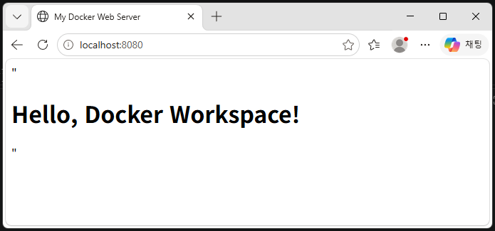
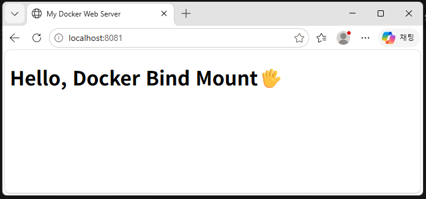

# Codyssey Workstation Mission
> 리눅스 CLI, Docker, Git/GitHub를 활용한 재현 가능한 개발 워크스테이션 환경 구축

---


## 📑 목차 (Table of Contents)
1. [제출 저장소(GitHub Repository)](#1-제출-저장소github-repository)
2. [기술 문서(README.md 등)](#2-기술-문서readmemd-등)
3. [터미널 조작 로그 (권한 실습 포함)](#3-터미널-조작-로그)
4. [Docker 운영/검증 로그](#4-docker-운영검증-로그)
5. [Dockerfile 기반 웹 서버 컨테이너](#5-dockerfile-기반-웹-서버-컨테이너)
6. [포트 매핑 접속 증거](#6-포트-매핑-접속-증거)
7. [바인드 마운트 반영 + 볼륨 영속성 증거](#7-바인드-마운트-반영--볼륨-영속성-증거)
8. [Git 설정 및 GitHub/VSCode 연동 증거](#8-git-설정-및-githubvscode-연동-증거)

<br><br><br>

---

## 1. 제출 저장소(GitHub Repository)
- **저장소 링크:** 
https://github.com/sosohappy79/ai-codyssey.git

<br><br>

---

## 2. 기술 문서(README.md 등)

### (1) 프로젝트 개요 (미션 목표 요약)
- **미션 목표:** 
표준화된 개발 워크스테이션 환경을 구축하고, 다중 머신(USB 기반 이동형 환경)에서도 동일하게 재현할 수 있도록 설정 및 실행 과정을 기록합니다.
<br>

### (2) 실행 환경
- OS: Windows (Docker Desktop / WSL2 Linux Backend)
- Shell / Terminal: Git Bash / VS Code Terminal
- Git 버전: 2.56.0
- Docker 버전: 29.9.2
<br>

### (3) 수행 항목 체크리스트

- [x] 터미널
- [x] 권한
- [x] Docker
- [x] Dockerfile
- [x] 포트
- [x] 마운트
- [x] 볼륨
- [x] Git
- [x] GitHub
<br>

### (4) 검증 방법 및 결과 위치
- **터미널 조작 및 권한:** `pwd`, `ls -la`, `chmod` 등 수행 ➔ [3. 터미널 조작 로그](#3-터미널-조작-로그)
- **Docker 운영 및 검증:** `docker --version`, `docker ps` 등 수행 ➔ [4. Docker 운영/검증 로그](#4-docker-운영검증-로그)
- **웹 서버 컨테이너:** `docker build`, `docker run` 실행 ➔ [5. Dockerfile 기반 웹 서버 컨테이너](#5-dockerfile-기반-웹-서버-컨테이너)
- **포트 매핑 접속:** 브라우저 접속 및 `curl` 확인 ➔ [6. 포트 매핑 접속 증거](#6-포트-매핑-접속-증거)
- **마운트 및 볼륨:** 데이터 변경/재시작 후 유효성 검증 ➔ [7. 바인드 마운트 반영 + 볼륨 영속성 증거](#7-바인드-마운트-반영--볼륨-영속성-증거)
- **Git/GitHub 연동:** 설정 확인 및 원격 저장소 연결 ➔ [8. Git 설정 및 GitHubVSCode 연동 증거](#8-git-설정-및-githubvscode-연동-증거)
<br>

### (5) 트러블슈팅
#### A. Windows(Git Bash) 환경에서 `chmod` 명령어를 통한 파일 및 디렉터리 권한 변경 미적용 현상
  - **문제 (Problem):**
    - Git Bash 환경에서 일반 파일 생성(`touch perm_test.txt`, `-rw-r--r--`) 후 `chmod 755 perm_test.txt`를 실행하거나, 디렉터리 생성(`mkdir perm_dir`, `drwxr-xr-x`) 후 `chmod 750 perm_dir`을 실행했음에도 `ls -l` 및 `ls -ld` 결과의 권한 표기가 기본값 그대로 유지되고 변경되지 않음.

  - **원인 가설 (Cause Hypothesis):**
    - Git Bash 터미널이 POSIX 명령어를 에뮬레이션하더라도, 하위 운영체제인 Windows의 기본 파일 시스템(NTFS)이 리눅스의 엄격한 소유자·그룹·기타 사용자(Owner/Group/Others) 권한 체계와 구조적으로 달라 로컬 접근 제어 목록(ACL)이 완벽하게 매핑되지 않을 것이라 가정함.

  - **확인 (Verification):**
    - `chmod` 명령어를 입력한 직후 `ls -l perm_test.txt`와 `ls -ld perm_dir`을 다시 수행하여 권한 문자열(`-rw-r--r--`, `drwxr-xr-x`) 변화 여부를 추적 검증함. 명령 실행 자체는 에러 없이 종료되나 파일 시스템 레벨에서 권한 변경 값이 반영되지 않음을 확인.

  - **해결 및 대안 (Solution / Alternative):**
    - 이는 명령어 구문이나 실습 절차의 오류가 아니라, Windows(NTFS) 파일 시스템과 Git Bash 터미널 환경의 구조적 한계에서 기인한 정상적인 제약 사항임을 확인함.
    - 향후 실제 리눅스 서버(Ubuntu 등)나 컨테이너(Docker) 환경에서는 POSIX 권한 체계가 완벽히 지원되므로, 운영체제 환경별 동작 차이를 인지하고 로컬 환경 제약 사항으로 기록함.

  - **증거 (실습 로그):** 
    - 자세한 실행 과정과 결과는 [권한 확인 및 변경 실습 (파일 및 디렉터리)](#8-권한-확인-및-변경-실습-파일-및-디렉터리) 섹션을 참고하세요.

<br><br>

#### B. Windows 환경에서 Docker 컨테이너 실행 시 이름 및 포트 충돌 현상
  - **문제 (Problem):**    
    - **이름 및 포트 충돌:** `docker run` 실행 시 이미 존재하는 컨테이너 이름으로 인해 `Conflict. The container name is already in use` 에러 발생, 또는 동일한 포트(`8080`)가 이미 점유되어 `port is already allocated` 에러 발생.
    - **경로 변환 오류 (`app;C` 폴더 생성):** Git Bash 환경에서 볼륨 매핑 옵션(`-v`)의 콜론(`:`) 기호와 윈도우 드라이브 경로가 충돌하여, 잘못된 형태의 `app;C` 폴더가 로컬에 생성되고 컨테이너 내부에서 `No such file or directory` 에러 발생.

  - **원인 가설 (Cause Hypothesis):**    
    - 도커는 시스템 내에서 컨테이너 이름과 호스트 포트를 고유하게 식별하므로 잔여 컨테이너가 있으면 충돌이 발생함.
    - 또한, Git Bash의 자동 경로 변환(MSYS path conversion) 기능이 도커의 절대 경로 매핑을 윈도우 드라이브 형식으로 왜곡하여 전달했기 때문으로 가정함.

  - **확인 (Verification):**
    - `docker ps -a` 명령어를 통해 점유 중인 컨테이너 목록을 확인.
    - 컨테이너 내부 파일 확인 명령어를 실행했을 때 `C:/Program Files/...` 형태로 경로가 꼬여 에러가 발생하는지 추적 검증함.
      ```bash
      docker exec -it bind-test-container-2 cat /usr/share/nginx/html/index.html
      ```

  - **해결 및 대안 (Solution / Alternative):**    
    - **이름/포트 충돌 해결:** 기존 컨테이너 강제 삭제 및 포트 번호 변경(`8081`) 적용.
      ```bash
      docker rm -f bind-test-container bind-test-container-2
      ```
    - **Git Bash 경로 오류 해결:** 명령어 앞에 `MSYS_NO_PATHCONV=1` 환경변수를 추가하여 경로 변환을 방지하고 정상적인 리눅스 스타일 절대 경로 매핑을 보장함.
      ```bash
      MSYS_NO_PATHCONV=1 docker run -d -p 8081:80 --name bind-test-container-2 -v "$(pwd)/app:/usr/share/nginx/html" nginx:alpine
      ```

  - **증거 (실습 로그):** 
    - **1) 이름/포트 충돌 에러 발생 예시:**      
      ```text
      docker: Error response from daemon: Conflict. The container name "/bind-test-container" is already in use...
      Bind for 0.0.0.0:8080 failed: port is already allocated
      cat: can't open 'C:/Program Files/Git/usr/share/nginx/html/index.html': No such file or directory
      ```
    - **2) 문제 해결 및 성공 실습 로그:**
      - 컨테이너 정리 및 컨테이너 ID 재생성
      ```bash      
      [명령어]
      $ docker rm -f bind-test-container bind-test-container-2
      [출력값]
      bind-test-container-2

      [명령어]
      $ MSYS_NO_PATHCONV=1 docker run -d -p 8081:80 --name bind-test-container-2 -v "$(pwd)/app:/usr/share/nginx/html" nginx:alpine
      [출력값]
      ea34a6bae110528298777cfdf55d2bb86d1d60a91f1e1025e1133e658ef16cf3
      ```
    - **3) 웹 브라우저 최종 검증:**
      - `http://localhost:8081` 접속 시 NGINX 초기 화면 및 바인드 마운트된 로컬 `app/` 파일 내용이 정상 출력되는 것을 확인함.
      - 자세한 실행 과정과 결과는 [(1) 바인드 마운트 (Bind Mount) 실습 증거](#1-바인드-마운트-bind-mount-실습-증거) 섹션을 참고하세요.

<br><br>

---

## 3. 터미널 조작 로그

### (1) 현재 위치 확인
```bash
[명령어]
$ pwd

[출력값]
/c/Users/User/ai-codyssey
```
<br>

### (2) 목록 확인 (숨김 파일 포함)
```bash
[명령어]
$ ls -la

[출력값]
total 20
drwxr-xr-x 1 User 197121    0 10월 30 10:53 ./
drwxr-xr-x 1 User 197121    0 10월 30 10:53 ../
drwxr-xr-x 1 User 197121    0 10월 30 11:04 .git/
-rw-r--r-- 1 User 197121 3511 10월 30 10:53 README.md
```
<br>

### (3) 이동
```bash
[명령어]
$ cd codyssey-file
pwd

[출력값]
/c/Users/User/ai-codyssey/codyssey-file
```
<br>

### (4) 생성
```bash
[명령어]
$ mkdir test_folder
cd test_folder
touch test_sample.txt
ls -la

[출력값]
total 0
drwxr-xr-x 1 User 197121 0 10월 30 11:49 ./
drwxr-xr-x 1 User 197121 0 10월 30 11:49 ../
-rw-r--r-- 1 User 197121 0 10월 30 11:49 test_sample.txt
```
<br>

### (5) 복사
```bash
[명령어]
$ cp test_sample.txt test_sample_backup.txt

[출력값]
total 0
drwxr-xr-x 1 User 197121 0 10월 30 11:51 ./
drwxr-xr-x 1 User 197121 0 10월 30 11:49 ../
-rw-r--r-- 1 User 197121 0 10월 30 11:49 test_sample.txt
-rw-r--r-- 1 User 197121 0 10월 30 11:51 test_sample_backup.txt
```
<br>

### (6) 이동/이름변경
```bash
[명령어]
$ mkdir backup_file
mv test_sample_backup.txt backup_file/renamed_sample.txt
cd backup_file
ls -la

[출력값]
total 4
drwxr-xr-x 1 User 197121 0 10월 30 11:57 ./
drwxr-xr-x 1 User 197121 0 10월 30 11:57 ../
-rw-r--r-- 1 User 197121 0 10월 30 11:51 renamed_sample.txt
```
<br>

### (7) 삭제
```bash
[명령어]
$ rm renamed_sample.txt
cd ..
rm -rf backup_file
ls -la

[출력값]
total 4
drwxr-xr-x 1 User 197121 0 10월 30 12:13 ./
drwxr-xr-x 1 User 197121 0 10월 30 11:49 ../
-rw-r--r-- 1 User 197121 0 10월 30 11:49 test_sample.txt
```
<br>

### (8) 권한 확인 및 변경 실습 (파일 및 디렉터리)
> **[📌권한 실습 증거 기록]** 파일 1개와 디렉터리 1개를 대상으로 권한(`chmod`)을 변경하고, 변경 전/후 상태를 비교한 로그입니다.

`chmod`(Change Mode의 약자)는 리눅스/유닉스 계열 터미널에서 파일이나 디렉터리의 권한(Access Permissions)을 변경할 때 사용하는 명령어입니다.

<br>

- **파일 권한 변경 실습 (`perm_test.txt`)**
```bash
[명령어]
$ touch perm_test.txt
$ ls -l perm_test.txt

[출력값]
-rw-r--r-- 1 User 197121 0 10월 30 15:57 perm_test.txt
```
>
```bash
[명령어]
$ chmod 755 perm_test.txt
$ ls -l perm_test.txt

[출력값]
-rw-r--r-- 1 User 197121 0 10월 30 15:57 perm_test.txt
```
💡 추가 설명: 일반 파일 생성 후 chmod 755를 실행하였으나, Windows 로컬 환경 특성상 비실행 파일에 대한 권한 표기 변경이 보류됨을 확인하였습니다.
[상세 내용은 트러블슈팅 참고](#5-트러블슈팅)

<br>

- **디렉터리 권한 변경 실습 (perm_dir/)**
```bash
[명령어]
$ mkdir perm_dir
$ ls -ld perm_dir


[출력값]
drwxr-xr-x 1 User 197121 0 10월 30 15:48 perm_dir/
```

```bash
[명령어]
$ chmod 750 perm_dir
$ ls -ld perm_dir

[출력값]
drwxr-xr-x 1 User 197121 0 10월 30 15:48 perm_dir/
```
💡 추가 설명: 디렉터리 생성 후 chmod 750을 실행하였으나, Windows 환경의 NTFS 파일 시스템 제약으로 인해 권한 상태가 기본값(drwxr-xr-x)으로 유지됨을 확인하였습니다.
[상세 내용은 트러블슈팅 참고](#5-트러블슈팅)

<br>

| 구분 | 작업 내용 | 명령어 (Command) | 설명 및 팁 |
| :--- | :--- | :--- | :--- |
| **1** | **현재 위치 확인** | `pwd` | 현재 작업 중인 폴더의 절대 경로를 출력합니다. |
| **2** | **목록 확인** | `ls -la` | 현재 폴더의 파일 및 폴더 목록을 상세히(`-l`), 숨김 파일(`-a`) 포함해서 보여줍니다. |
| **3** | **이동 (경로 변경)** | `cd [폴더명]`<br>`cd ..` | 특정 폴더 안으로 진입하거나(`cd`), 상위 폴더로 빠져나옵니다(`cd ..`). |
| **4** | **생성** | `mkdir [폴더명]`<br>`touch [파일명]` | 새로운 폴더를 만들거나(`mkdir`), 크기가 0바이트인 빈 파일을 만듭니다(`touch`). |
| **5** | **복사** | `cp [원본] [복사본]` | 파일이나 폴더를 복사하여 새로운 이름이나 위치로 만듭니다. |
| **6** | **이동 및 이름 변경** | `mv [원본] [경로/새이름]` | 파일을 다른 폴더로 이동시키면서 동시에 이름까지 한 번에 바꿉니다. |
| **7** | **삭제** | `rm [파일명]`<br>`rm -rf [폴더명]` | 파일은 `rm`으로 삭제하고, 내용물이 있는 폴더는 강제/재귀 옵션(`-rf`)을 붙여 통째로 삭제합니다. |
| **8** | **권한 변경** | `chmod [권한값] [대상]` | 파일이나 디렉터리의 읽기·쓰기·실행 권한(`rwx`)을 숫자로 변경합니다. (예: `755`, `750`) |

<br><br>

---

## 4. Docker 운영/검증 로그
### (1) Docker 버전 및 데몬 점검
```bash
[명령어]
$ docker --version
$ docker info

[출력 결과 (요약 및 주요 항목)]
Docker version 29.9.2, build a82e528
Client: (Docker CLI 및 빌드/컴포즈 등 플러그인 정상 로드 확인)
Server:
  Containers: 0 (실행 중인 컨테이너 없음)
  Images: 0 (다운로드된 이미지 없음)
  Server Version: 29.9.2
  Operating System: Docker Desktop
  Kernel Version: 6.18.54.1-microsoft-standard-WSL2
  Architecture: x86_64

```
<br>

### (2) Docker 기본 운영 및 컨테이너 실습

<a id="section-1"></a>

#### ① 테스트 컨테이너 실행 (`hello-world`)

- `hello-world` 이미지를 다운로드하고 컨테이너를 실행하여 Docker가 정상 작동하는지 검증했습니다.

```bash
[명령어]
$ docker run hello-world

[출력값]
Unable to find image 'hello-world:latest' locally
latest: Pulling from library/hello-world
... (중간 다운로드 로그 생략) ...
Status: Downloaded newer image for hello-world:latest

Hello from Docker!
This message shows that your installation appears to be working correctly.
```
<br>

#### ② 우분투 컨테이너 실행 및 내부 진입 (ubuntu)
- ubuntu 컨테이너를 대화형 모드(-it)로 실행하여 내부 셸에 진입한 뒤, 간단한 명령어 수행 후 빠져나왔습니다.
```bash
[명령어]
$ docker run -it ubuntu bash
$ ls
$ echo "Hello Docker"
$ exit

[출력값]
Unable to find image 'ubuntu:latest' locally
latest: Pulling from library/ubuntu
edafa32f5d9e: Pull complete 
f3f25b84a7d7: Pull complete 
21594acc2d8b: Download complete 
Digest: sha256:6a06111c3b0a8600feadb270aec771dc239bf407b25625f93f44ab00e11f4d3c
Status: Downloaded newer image for ubuntu:latest
root@8c889904fb07:/# exit
```
<br>

#### 📌 컨테이너 실행 및 유지 방식 비교 (attach vs exec, 포그라운드 vs 백그라운드)

| 구분 | 명령어 예시 | 설명 및 특징 (생명주기 및 셸 진입 방식) |
| :--- | :--- | :--- |
| **포그라운드 실행** | `docker run -it [이미지]` | 터미널을 통해 컨테이너 내부 셸(`bash`)과 직접 상호작용하며 진입합니다. `exit` 입력 시 컨테이너가 곧바로 종료(`Exited`)됩니다. |
| **백그라운드 실행** | `docker run -d [이미지]` | 컨테이너를 백그라운드에서 독립적으로 실행하여 터미널을 점유하지 않고 계속 유지되도록 만듭니다. |
| **실시간 연결** | `docker attach [컨테이너명]` | 이미 실행 중인 백그라운드 컨테이너의 표준 입출력(I/O)에 실시간으로 다시 달라붙습니다. (※ 주의: 내부에서 `exit`이나 `Ctrl + C`를 누르면 컨테이너 자체가 정지될 수 있음) |
| **안전한 접속 (권장)** | `docker exec -it [컨테이너명] bash` | 실행 중인 컨테이너에 새로운 셸 프로세스를 띄워 안전하게 접속합니다. 작업 후 `exit`으로 빠져나와도 컨테이너는 정지되지 않고 백그라운드에서 계속 유지됩니다. |
<br>

<a id="section-3"></a>

#### ③ 이미지 및 컨테이너 목록 확인, 리소스 점검
- 다운로드된 이미지 목록, 중지/실행 중인 전체 컨테이너 목록, 그리고 컨테이너의 실시간 리소스 사용량을 점검했습니다.

```bash
[명령어]
$ docker images
$ docker ps -a
$ docker stats --no-stream

[출력값]
# docker images 결과
IMAGE               ID             DISK USAGE    CONTENT SIZE   EXTRA
hello-world:latest  c567b231f656   25.9kB        9.49kB         U    
ubuntu:latest       6a06111c3b0a   163MB         45.9MB         U    

# docker ps -a 결과
CONTAINER ID   IMAGE         COMMAND    CREATED          STATUS                     PORTS     NAMES
a4987370cf32   ubuntu        "bash"     11 minutes ago   Exited (0) 5 minutes ago             blissful_chatelet
076be21573ac   ubuntu        "bash"     13 minutes ago   Exited (0) 5 minutes ago             pedantic_ramanujan
8c889904fb07   ubuntu        "bash"     23 minutes ago   Exited (0) 12 minutes ago            sharp_sanderson
fb11d3f1ff35   hello-world   "/hello"   32 minutes ago   Exited (0) 26 minutes ago            affectionate_cori

# docker stats --no-stream 결과
CONTAINER ID   NAME      CPU %     MEM USAGE / LIMIT     MEM %     NET I/O     BLOCK I/O   PIDS
(현재 실행 중인 컨테이너가 없어 헤더만 출력됨)
```

<br><br>

### (3) Docker 기본 운영 미션 수행 요약 

| 구분 | 미션 항목 | 수행 명령어 | 수행 여부 및 결과 요약 |
| :---: | :--- | :--- | :--- |
| **이미지** | 다운로드 및 목록 확인 | [`docker images`](#section-3) | `hello-world`, `ubuntu` 이미지 다운로드 완료 및 목록/용량 확인 |
| **컨테이너** | 실행 / 중지 / 목록 확인 | [`docker ps` / `docker ps -a`](#section-3) | 테스트 및 우분투 컨테이너 실행 후 종료 상태(`Exited`) 확인 |
| **운영** | 로그 확인 | [`docker logs`](#section-1) | 컨테이너 구동 및 실행 결과 로그(Hello from Docker 등) 확인 |
| **운영** | 리소스 확인 | [`docker stats`](#section-3) | `docker stats --no-stream` 실행하여 리소스 점검 완료 |

<br><br>

---

## 5. Dockerfile 기반 웹 서버 컨테이너
### ① 웹 서버 소스코드 및 디렉터리 구조
- 웹 서버 배포를 위해 프로젝트 루트 디렉터리에 `app/` 폴더를 생성하고, 기본으로 표시할 `index.html` 파일을 작성했습니다.

```text
ai-codyssey/
├── Dockerfile
└── app/
    └── index.html
```
<br>

### ② Dockerfile 작성 및 커스텀 포인트 (A안 선택)
```dockerfile
FROM nginx:alpine
LABEL maintainer="user"
COPY app/ /usr/share/nginx/html/
```
- **베이스 이미지**: `nginx:alpine`
  - **선택 이유**: 가볍고 빠르게 동작하는 NGINX 웹 서버 경량 이미지 활용
- **커스텀 포인트 1 (정적 콘텐츠 커스텀):** 
  - 내용: 로컬의 `app/` 디렉터리에 있는 정적 HTML 파일을 NGINX의 기본 웹 루트 경로(`/usr/share/nginx/html/`)로 복사(`COPY`)
  - 목적: 기본 Nginx 환영 페이지 대신 사용자가 직접 작성한 커스텀 웹 페이지가 기본 화면으로 노출되도록 설정
- **커스텀 포인트 2 (네트워크 및 포트 구성):** 
  - 내용: 컨테이너 내부의 `80`번 포트를 호스트의 `8080`번 포트와 연결(`-p 8080:80`)
  - 목적: 방화벽이나 내부망에 구애받지 않고 외부 호스트 머신의 브라우저를 통해 웹 서버에 원활하게 접근할 수 있도록 네트워크 통신 경로 확보

<br>

### ③ 빌드/실행 명령 및 결과 로그
- **커스텀 이미지 빌드 명령어 및 결과**
```bash
[명령어]
$ docker build -t my-custom-web:1.0 .

[출력값]
[+] Building 9.1s (7/7) FINISHED
=> [internal] load build definition from Dockerfile                                            0.1s
=> [internal] load metadata for docker.io/library/nginx:alpine                                 2.2s
=> [1/2] FROM docker.io/library/nginx:alpine                                                   4.7s
    ...(중간 레이어 다운로드 및 추출 과정 생략)...
=> [2/2] COPY app/ /usr/share/nginx/html/                                                      0.1s
=> exporting to image                                                                          1.8s
=> naming to docker.io/library/my-custom-web:1.0                                               0.0s
```
<br>

- **컨테이너 실행 명령어 및 상태 확인 로그 ('docker ps')**
```bash
[명령어]
$ docker ps

[출력값]
CONTAINER ID   IMAGE                 COMMAND                  CREATED         STATUS         PORTS                  NAMES
d0cb5df6f161   my-custom-web:1.0     "/docker-entrypoint.…"   2 minutes ago   Up 2 minutes   0.0.0.0:8080->80/tcp   web-container
```
<br>

### ④ 포트 매핑 접속 성공 증거 (통신 테스트 로그)
```bash
[명령어]
$ curl -I http://localhost:8080

[출력값 (컨테이너 ID)]
HTTP/1.1 200 OK
Server: nginx/1.31.8
Date: Sat, 31 Oct 2026 09:09:22 GMT
Content-Type: text/html
Content-Length: 127
Last-Modified: Fri, 30 Oct 2026 14:46:21 GMT
Connection: keep-alive
ETag: "6ae4adbd-7f"
Accept-Ranges: bytes
```
<br><br>

---

## 6. 포트 매핑 접속 증거
- **접속 주소:** `http://localhost:8080`
- **통신 및 접속 확인:** 호스트 머신에서 브라우저를 통해 포트 `8080`으로 접근 시, 컨테이너 내부의 Nginx 웹 서버가 정상 응답하여 커스텀 웹페이지가 출력되는 것을 확인함.

<br>

- **컨테이너 실행 및 ID 확인:** 
  ```bash
  [명령어]
  $ docker run -d -p 8080:80 --name web-container my-custom-web:1.0

  [출력값 (컨테이너 ID)]
  d0cb5df6f16130ae09b52a96b55ae4fc94a8b5ba841eb080de1c416c8dff858d
  ```

<br>

- **통신 테스트 (curl) 성공 로그:**
  ```bash
  [명령어]
  $ curl http://localhost:8080

  [출력값]
  "<!DOCTYPE html><html><head><title>My Docker Web Server</title></head><body><h1>Hello, Docker Workspace!</h1></body></html>" 
  ```

<br>

- **브라우저 접속 화면 스크린샷(주소창 포함):**

  

<br><br>

---

## 7. 바인드 마운트 반영 + 볼륨 영속성 증거

### (1) 바인드 마운트 (Bind Mount) 실습 증거
- **실행 환경:** Windows (PowerShell / Git Bash)
- **실습 목적:** 호스트 머신의 로컬 디렉터리(`app/`)를 NGINX 컨테이너 내부의 웹 루트 디렉터리(`/usr/share/nginx/html`)에 바인드 마운트하여 실시간으로 웹 페이지가 연동되는지 검증함.

- **실행 명령어 (Windows Git Bash 환경 및 포트 8081 적용):**
  ```bash
  [명령어]
  $ MSYS_NO_PATHCONV=1 docker run -d -p 8081:80 --name bind-test-container-2 -v "$(pwd)/app:/usr/share/nginx/html" nginx:alpine

  [출력값]
  ea34a6bae110528298777cfdf55d2bb86d1d60a91f1e1025e1133e658ef16cf3
  ```
<br>

- **호스트 변경 전/후 비교 검증:**
  - **변경 전 (호스트 파일 수정 전)**: 호스트의 app/index.html 원본 파일 상태에서 http://localhost:8081 접속 시 초기 웹 페이지 내용이 정상 출력되는 것을 확인함.
  - **변경 후 (호스트 파일 수정 후)**: 호스트에서 app/index.html 파일의 문구를 수정한 직후, 컨테이너를 재시작하지 않은 상태에서 브라우저를 새로고침(F5)하여 변경된 문구가 화면에 즉시 반영되는 것을 최종 검증함.

<br>

- **통신 테스트 (curl) 성공 로그:**
  ```bash
  [명령어]
  $ curl http://localhost:8081

  [출력값]
  <!DOCTYPE html>
  <html lang="ko">
  <head>
      <meta charset="UTF-8">
      <title>My Docker Web Server</title>
  </head>
  <body>
      <h1>Hello, Docker Bind Mount🖐️</h1>
  </body>
  </html> 
  ```
<br>

- **브라우저 접속 화면 스크린샷(주소창 포함):**

  

<br>

### (2) Docker 볼륨 영속성 검증 (Docker Volume Persistence)

- **개념:** 도커 볼륨(Volume)은 컨테이너 생명주기와 독립적으로 호스트 시스템의 Docker 관리 영역(`/var/lib/docker/volumes/...`)에 데이터를 저장하므로, **컨테이너가 삭제되어도 데이터가 유실되지 않고 영구적으로 유지**되는 특성을 가짐.
<BR>

#### ① Docker 볼륨 생성 (Create Volume)
- 새로운 도커 볼륨(`codyssey-vol`)을 생성하여 독립적인 저장 공간을 확보함.
  ```bash
  [명령어]
  $ docker volume create codyssey-vol

  [출력값]
  codyssey-vol
  ```
<BR>

#### ② Docker 볼륨 연결 및 데이터 작성
- 생성한 볼륨을 새 컨테이너(volume-test-container)의 /data 경로에 연결(-v)하고, 내부에 테스트용 파일(persisted.txt)을 생성하여 데이터를 기록함.
  ```bash
  [명령어]
  $ docker run -d --name volume-test-container -v codyssey-vol:/data alpine sh -c "echo 'Hello, Docker Volume!' > /data/persisted.txt && sleep 3600" 

  [출력값]
  402071d738c99d10f07deda3c1b85aba5b8b9d880f4d40e9a9a0019a37a1afae
  ```
<BR>

#### ③ Docker 볼륨 영속성 검증 (컨테이너 삭제 전/후 비교)
- **삭제 전 데이터 확인**: 컨테이너가 실행 중인 상태에서 내부 파일에 접근하여 데이터가 정상 기록되었는지 확인.
  ```bash
  [명령어]
  $ docker exec -it volume-test-container cat /data/persisted.txt

  [출력값]
  Hello, Docker Volume!
  ```
<BR>

- **컨테이너 강제 삭제**: 볼륨의 영속성을 테스트하기 위해 현재 실행 중인 컨테이너를 강제로 삭제합니다.
  ```bash
  [명령어]
  $ docker rm -f volume-test-container

  [출력값]
  volume-test-container
  ```
<BR>

- **삭제 후 데이터 영속성 최종 검증**: 기존 컨테이너가 사라진 상태에서, **새로운 컨테이너**를 띄워 동일한 볼륨(`codyssey-vol`)을 다시 연결하고 데이터가 안전하게 유지되는지 최종 확인합니다.
  ```bash
  [명령어]
  $ docker run --rm -v codyssey-vol:/data alpine cat /data/persisted.txt

  [출력값]
  Hello, Docker Volume!
  ```

  ---
  > **결론:** 컨테이너가 완전히 제거되었음에도 도커 볼륨에 저장된 데이터는 유실되지 않고 안전하게 보존됨을 최종 검증함.
  <BR>


<br><br>

---

## 8. Git 설정 및 GitHub/VSCode 연동 증거

### (1) Git 사용자 정보 및 기본 브랜치 설정
- Git 글로벌 사용자 이름, 이메일, 기본 브랜치(`main`)를 설정하고 등록된 전체 설정을 확인했습니다.

```bash
[명령어]
$ git config --global user.name "전소영"
$ git config --global user.email "sosohappy79@google.com"
$ git config --global init.defaultBranch main
$ git config --global --list

[출력값]
core.editor="C:\Users\User\AppData\Local\Programs\Microsoft VS Code\bin\code" --wait
user.name=전소영
user.email=sosohappy79@google.com
init.defaultbranch=main
```
<br>

### (2) GitHub 원격 저장소 연동 확인
- VS Code에서 GitHub 계정 로그인 후, 해당 프로젝트 로컬 저장소를 GitHub 원격 저장소(`origin`)와 성공적으로 연결했습니다.

```bash
[명령어]
$ git remote -v

[출력값]
origin  https://github.com/sosohappy79/ai-codyssey.git (fetch)
origin  https://github.com/sosohappy79/ai-codyssey.git (push)
```
