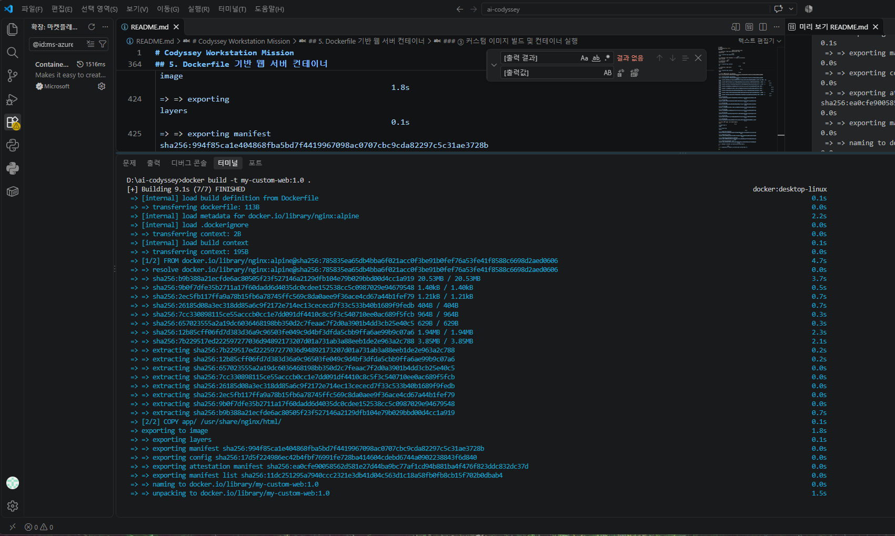
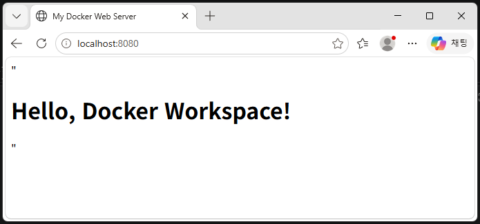
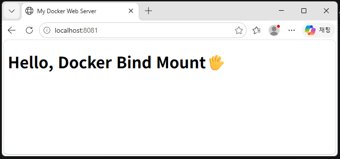
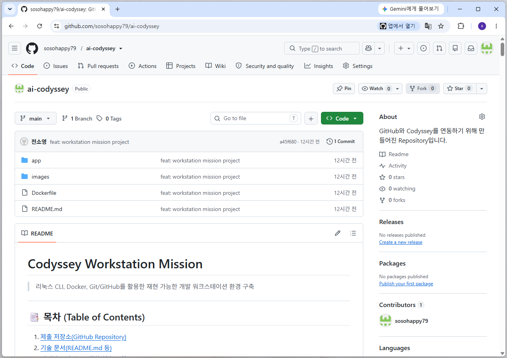
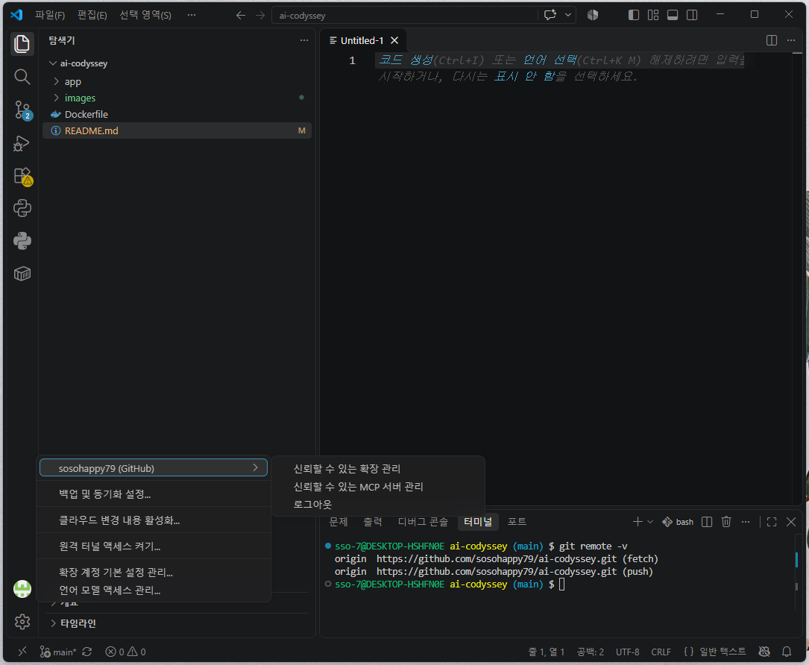

# Codyssey Workstation Mission
> 리눅스 CLI, Docker, Git/GitHub를 활용한 재현 가능한 개발 워크스테이션 환경 구축

---

## 📑 목차 (Table of Contents)
1. [제출 저장소 (GitHub Repository)](#1-제출-저장소-github-repository)
2. [기술 문서](#2-기술-문서)
   - [2-1. 프로젝트 개요](#2-1-프로젝트-개요-미션-목표-요약)
   - [2-2. 실행 환경](#2-2-실행-환경)
   - [2-3. 수행 항목 체크리스트](#2-3-수행-항목-체크리스트)
   - [2-4. 검증 방법 및 결과 위치](#2-4-검증-방법-및-결과-위치)
   - [2-5. 트러블슈팅](#2-5-트러블슈팅)
3. [터미널 조작 로그](#3-터미널-조작-로그)
   - [3-1. 현재 위치 확인](#3-1-현재-위치-확인)
   - [3-2. 목록 확인 (숨김 파일 포함)](#3-2-목록-확인-숨김-파일-포함)
   - [3-3. 이동](#3-3-이동)
   - [3-4. 생성](#3-4-생성)
   - [3-5. 복사](#3-5-복사)
   - [3-6. 이동 및 이름 변경](#3-6-이동-및-이름-변경)
   - [3-7. 삭제](#3-7-삭제)
   - [3-8. 파일 내용 확인](#3-8-파일-내용-확인)
   - [3-9. 빈 파일 생성](#3-9-빈-파일-생성)
   - [3-10. 권한 확인 및 변경 실습](#3-10-권한-확인-및-변경-실습-파일-및-디렉터리)
4. [Docker 운영/검증 로그](#4-docker-운영검증-로그)
   - [4-1. Docker 버전 및 데몬 점검](#4-1-docker-버전-및-데몬-점검)
   - [4-2. Docker 기본 운영 및 컨테이너 실습](#4-2-docker-기본-운영-및-컨테이너-실습)
   - [4-3. Docker 기본 운영 미션 수행 요약](#4-3-docker-기본-운영-미션-수행-요약)
5. [Dockerfile 기반 웹 서버 컨테이너](#5-dockerfile-기반-웹-서버-컨테이너)
   - [5-1. 웹 서버 소스코드 및 디렉터리 구조](#5-1-웹-서버-소스코드-및-디렉터리-구조)
   - [5-2. Dockerfile 작성 및 커스텀 포인트](#5-2-dockerfile-작성-및-커스텀-포인트-a안-선택)
   - [](#5-3-빌드실행-명령-및-결과-로그)
   - [5-4. 포트 매핑 접속 성공 증거](#5-4-포트-매핑-접속-성공-증거-통신-테스트-로그)
6. [포트 매핑 접속 증거](#6-포트-매핑-접속-증거)
7. [바인드 마운트 반영 + 볼륨 영속성 증거](#7-바인드-마운트-반영--볼륨-영속성-증거)
   - [7-1. 바인드 마운트 실습 증거](#7-1-바인드-마운트-bind-mount-실습-증거)
   - [7-2. Docker 볼륨 영속성 검증](#7-2-docker-볼륨-영속성-검증-docker-volume-persistence)
8. [Git 설정 및 GitHub/VSCode 연동 증거](#8-git-설정-및-githubvscode-연동-증거)
   - [8-1. Git 사용자 정보 및 기본 브랜치 설정](#8-1-git-사용자-정보-및-기본-브랜치-설정)
   - [8-2. GitHub 원격 저장소 연동 확인](#8-2-github-원격-저장소-연동-확인)
9. [보너스 과제 (Bonus Missions)](#9-보너스-과제-bonus-missions)
   - [9-1. Docker Compose 기초 (단일 서비스)](#9-1-docker-compose-기초-단일-서비스)
   - [9-2. Docker Compose 멀티 컨테이너 & 네트워크 통신](#9-2-docker-compose-멀티-컨테이너--네트워크-통신)
   - [9-3. Compose 운영 명령어 습득](#9-3-compose-운영-명령어-습득)
   - [9-4. 환경 변수 활용 (설정과 코드의 분리)](#9-4-환경-변수-활용-설정과-코드의-분리)
   - [9-5. GitHub SSH 키 설정 및 인증 검증](#9-5-github-ssh-키-설정-및-인증-검증)


<br><br><br>

---

## 1. 제출 저장소 (GitHub Repository)
- **저장소 링크:** 
https://github.com/sosohappy79/ai-codyssey.git

<br><br>

---

## 2. 기술 문서

### 2-1. 프로젝트 개요 (미션 목표 요약)
- **미션 목표:** 
표준화된 개발 워크스테이션 환경을 구축하고, 다중 머신(USB 기반 이동형 환경)에서도 동일하게 재현할 수 있도록 설정 및 실행 과정을 기록합니다.
<br>

### 2-2. 실행 환경

| 항목 | 내용 |
|------|------|
| OS | Windows (Docker Desktop / WSL2 Linux Backend) |
| Shell / Terminal | Git Bash / VS Code Terminal |
| Git 버전 | 2.56.0 |
| Docker 버전 | 29.9.2 |
<br>

**[실행 환경 버전 확인 로그]**

  ```bash
  [명령어]
  $ git --version
  $ docker --version

  [출력값]
  git version 2.56.0.windows.3
  Docker version 29.9.2, build a82e528
  ```

<br>

### 2-3. 수행 항목 체크리스트
#### [기본 과제]
| 수행 항목 | 상태 | 수행 항목 | 상태 | 수행 항목 | 상태 | 수행 항목 | 상태 | 수행 항목 | 상태 |
| :--- | :---: | :--- | :---: | :--- | :---: | :--- | :---: | :--- | :---: |
| **- [터미널](#3-터미널-조작-로그)** | ✅ 완료 | **- [권한](#3-10-권한-확인-및-변경-실습-파일-및-디렉터리)** | ✅ 완료 | **- [Docker](#4-docker-운영검증-로그)** | ✅ 완료 | **- [Dockerfile](#5-dockerfile-기반-웹-서버-컨테이너)** | ✅ 완료 | **- [포트](#5-4-포트-매핑-접속-성공-증거-통신-테스트-로그)** | ✅ 완료 |
| **- [마운트](#7-1-바인드-마운트-bind-mount-실습-증거)** | ✅ 완료 | **- [볼륨](#7-2-docker-볼륨-영속성-검증-docker-volume-persistence)** | ✅ 완료 | **- [Git](#8-git-설정-및-githubvscode-연동-증거)** | ✅ 완료 | **- [GitHub](#8-2-github-원격-저장소-연동-확인)** | ✅ 완료 | - | - |
<br>

#### [보너스 과제]
| 수행 항목 | 상태 | 수행 항목 | 상태 | 수행 항목 | 상태 | 수행 항목 | 상태 | 수행 항목 | 상태 |
| :--- | :---: | :--- | :---: | :--- | :---: | :--- | :---: | :--- | :---: |
| **- [Compose 기초](#9-1-docker-compose-기초-단일-서비스)** | ✅ 완료 | **- [멀티 컨테이너](#9-2-docker-compose-멀티-컨테이너--네트워크-통신)** | ✅ 완료 | **- [운영 명령어](#9-3-compose-운영-명령어-습득)** | ✅ 완료 | **- [환경 변수](#9-4-환경-변수-활용-설정과-코드의-분리)** | ✅ 완료 | **- [GitHub SSH](#9-5-github-ssh-키-설정-및-인증-검증)** | ✅ 완료 |

<br>

### 2-4. 검증 방법 및 결과 위치
| 항목 | 검증 명령어 | 검증 방법 | 확인 결과 | 결과 위치 |
|------|-----------|-----------|-----------|-----------|
| **3. 터미널 기본 조작** | `pwd` `ls -la` `cd` `mkdir` `touch` `cp` `mv` `rm` | 각 명령 실행 후 출력값으로 동작 확인 | 경로·목록·생성·복사·이동·삭제 정상 수행 확인 | [3. 터미널 조작 로그](#3-터미널-조작-로그) |
| **3-8~3-9. 파일 내용 확인 및 빈 파일 생성** | `cat test_sample.txt` `touch test_sample.txt` | 파일 내용 확인 후 `touch`로 파일 갱신 및 `ls -la` 출력값 확인 | `Hello, Codyssey!` 정상 출력 및 `test_sample.txt` 파일 생성·갱신 확인 | [3-8. 파일 내용 확인](#3-8-파일-내용-확인) <br> [3-9. 빈 파일 생성](#3-9-빈-파일-생성) |
| **3-10. 권한 변경 실습** | `ls -l perm_test.txt` → `chmod 755` → `ls -l` <br> `ls -ld perm_dir` → `chmod 750` → `ls -ld` | 변경 **전** `ls -l` 출력 기록 → chmod 수행 → 변경 **후** `ls -l` 출력 비교 | 파일·디렉터리 각 1개 권한 변경 전/후 출력값 비교 확인 (Windows NTFS 제약 포함 기록) | [3-10. 권한 확인 및 변경 실습](#3-10-권한-확인-및-변경-실습-파일-및-디렉터리) |
| **4-1. Docker 버전 확인 및 데몬 점검** | `docker --version` `docker info` | 버전 출력 및 데몬 상태 정보 확인 (데몬 상태 정보: 컨텍스트·스토리지·OS 등 출력값 확인) | Docker v29.9.2 정상 출력 확인 및 데몬 정상 작동 (상세 정보 출력) 확인 | [4-1. Docker 버전 및 데몬 점검](#4-1-docker-버전-및-데몬-점검) |
| **4-2. 컨테이너 실행 및 대화형 진입 실습** | `docker run hello-world`<br>`docker run -it ubuntu bash` + `ls` `echo` | 실행 후 메시지 확인 및 ubuntu 내부 셸 진입 후 리눅스 명령어 수행 | `hello-world` 출력 확인 및 ubuntu 내부 `ls`·`echo` 수행 후 `exit` 확인 | [4-2. ①/② 컨테이너 실행 및 대화형 진입](#4-2-docker-기본-운영-및-컨테이너-실습) |
| **4-2. 이미지 및 컨테이너 목록·리소스 점검** | `docker images` `docker ps -a` `docker stats --no-stream` | 다운로드된 이미지, 전체 컨테이너(종료 포함) 및 리소스 사용량 수치 확인 | 이미지(`hello-world`, `ubuntu`) 목록 및 전체 컨테이너 상태, 리소스 정상 출력 확인 | [4-2. ④ 이미지 및 컨테이너 목록 확인, 리소스 점검](#4-2-docker-기본-운영-및-컨테이너-실습) |
| **4-2. 컨테이너 로그 확인** | `docker logs bind-test-container-2` | 백그라운드 컨테이너의 표준 출력 및 접속/에러 로그 확인 | NGINX 구동 프로세스 및 HTTP 요청 접속 로그 정상 출력 확인 | [4-2. ⑤ 컨테이너 로그 확인](#4-2-docker-기본-운영-및-컨테이너-실습) |
| **4-2. attach/exec 차이 관찰** | `docker attach` `docker exec -it` | 두 방식 각각 실행 후 종료 시 컨테이너 상태(`docker ps -a`) 비교 | attach 종료 시 컨테이너 중지 / exec 종료 시 컨테이너 유지 차이 확인 및 정리 | [4-2. Docker 기본 운영 및 컨테이너 실습](#attach-exec-compare) |
| **5-1. 웹서버 소스코드 존재 확인** | `ls -la app/` | `app/` 디렉터리 내 소스파일 목록 출력 확인 | `index.html` 등 정적 소스파일 정상 존재 확인 | [5-1. 웹 서버 소스코드 및 디렉터리 구조](#5-1-웹-서버-소스코드-및-디렉터리-구조) |
| **5-2. Dockerfile 내용 확인** | `cat Dockerfile` | `Dockerfile` 출력으로 `FROM`,`LABEL`,`COPY `구성 확인 | `Dockerfile` 정상 작성 및 내용 확인 | [5-2. Dockerfile 작성 및 커스텀 포인트](#5-2-dockerfile-작성-및-커스텀-포인트-a안-선택) |
| **5-2. 베이스 선택 이유 및 커스텀 포인트 목적** | `Dockerfile` `FROM nginx:alpine`, `COPY`, `LABEL` 구성 확인 | 선택 이유 + 커스텀 포인트별 목적 요약 기록 확인 | `nginx:alpine` 선택 이유 및 커스텀 포인트(정적 콘텐츠 복사 및 메타데이터 `LABEL` 추가 목적) 문서 확인 | [5-2. Dockerfile 작성 및 커스텀 포인트](#5-2-dockerfile-작성-및-커스텀-포인트-a안-선택) |
| **5-3. 커스텀 이미지 빌드** | `docker build -t my-custom-web:1.0 .` | 빌드 성공 메시지 확인 | 커스텀 웹 서버 이미지 정상 빌드 완료 확인 | [5-3. 빌드/실행 명령 및 결과 로그](#5-3-빌드실행-명령-및-결과-로그) |
| **6. 포트 매핑 접속** | `curl http://localhost:8080` + 브라우저 접속 | curl 응답 코드 및 브라우저 화면으로 접속 확인 | HTTP 200 OK + 커스텀 HTML 정상 출력 (8080/8081(7-1참고) 각각 확인) | [6. 포트 매핑 접속 증거](#6-포트-매핑-접속-증거) |
| **7-1. 바인드 마운트** | `docker run -v "$(pwd)/app:/usr/share/nginx/html"` + 호스트 파일 수정 | 호스트 파일 수정 **전** 브라우저 확인 → 수정 → **후** 새로고침으로 즉시 반영 확인 | 컨테이너 재시작 없이 변경 내용 즉시 반영 확인 | [7-1. 바인드 마운트 실습 증거](#7-1-바인드-마운트-bind-mount-실습-증거) |
| **7-2. 볼륨 영속성 검증** | `docker volume create codyssey-vol` → 컨테이너 연결·데이터 저장 → `docker rm -f` → 새 컨테이너 `cat` 재확인 | 컨테이너 삭제 **전** 데이터 확인 → 삭제 → 새 컨테이너에서 동일 데이터 재확인 (3단계) | 삭제 후에도 `Hello, Docker Volume!` 데이터 유지 확인 | [7-2. Docker 볼륨 영속성 검증](#7-2-docker-볼륨-영속성-검증-docker-volume-persistence) |
| **8-1. Git 설정 확인** | `git config --global user.name` `user.email` `init.defaultBranch` `git config --local --list` | `git config --local --list` 출력값으로 전체 설정 확인 | 사용자 정보·기본 브랜치·에디터 설정 정상 확인 | [8-1. Git 사용자 정보 및 기본 브랜치 설정](#8-1-git-사용자-정보-및-기본-브랜치-설정) |
| **8-2. GitHub 연동 확인** | `git remote -v` `git log --oneline` `git status` + VSCode 연동 스크린샷 | 원격 저장소 URL·커밋 이력·Push 상태 출력값 확인 + VSCode GitHub 로그인 화면 첨부 | 원격 연결·커밋 이력·Push 완료 및 VSCode 연동 정상 확인 | [8-2. GitHub 원격 저장소 연동 확인](#8-2-github-원격-저장소-연동-확인) |
| **9-1. Compose 기초** | `docker compose up -d`<br>`curl -I http://localhost:8082` | 단일 서비스 백그라운드 실행 및 HTTP 응답 상태 코드 확인 | NGINX 200 OK 응답 정상 확인 | [9-1. Docker Compose 기초](#9-1-docker-compose-기초-단일-서비스) |
| **9-2. 멀티 컨테이너** | `docker compose -f docker-compose.multi.yml up -d`<br>`docker exec -it multi-web-app ping -c 2 redis-cache` | 멀티 컨테이너 동시 구동 및 컨테이너 간 내부 네트워크(DNS) 통신 테스트 | 패킷 손실률 0% 통신 성공 확인 | [9-2. 멀티 컨테이너](#9-2-docker-compose-멀티-컨테이너--네트워크-통신) |
| **9-3. 운영 명령어** | `docker compose ps`<br>`docker compose logs`<br>`docker compose down` | 상태(`ps`), 로그(`logs`), 종료 및 자원 정리(`down`) 수행 | 서비스 생명주기 관리 루틴 정상 작동 확인 | [9-3. Compose 운영 명령어](#9-3-compose-운영-명령어-습득) |
| **9-4. 환경 변수** | `docker compose -f docker-compose.env.yml up -d`<br>`docker exec -it env-web-container printenv APP_ENV` | `.env` 파일 설정값 연동 및 컨테이너 내부 환경 변수 주입 검증 | 설정값이 정상적으로 주입됨을 확인 | [9-4. 환경 변수 활용](#9-4-환경-변수-활용-설정과-코드의-분리) |
| **9-5. GitHub SSH** | `ssh-keygen -t ed25519`<br>`ssh -T git@github.com`<br>`git push origin main` | SSH 키쌍 생성, 공개키 등록, 인증 테스트 및 푸시 검증 | "Successfully authenticated" 메시지 및 Push 완료 | [9-5. GitHub SSH 키 설정](#9-5-github-ssh-키-설정-및-인증-검증) |
| **공통. 보안·민감정보 마스킹** | 기술 문서·스크린샷 전체 육안 검토 | 토큰·비밀번호·개인키·인증코드 포함 여부 전수 확인 및 민감정보 노출 시 마스킹 처리| 토큰, 비밀번호, 개인키 등 민감정보 미포함 확인 | 전체 문서 및 첨부 이미지 |
<br>

### 2-5. 트러블슈팅
#### A. Windows(Git Bash) 환경에서 `chmod` 명령어를 통한 파일 및 디렉터리 권한 변경 미적용 현상
<br>
<details>
<summary>요약 : 윈도우(Git Bash)에서 chmod 권한이 안 바뀌는 이유</summary>

윈도우(Git Bash)는 리눅스의 권한 체계(`rwx`)를 지원하지 않는 파일 시스템(`NTFS`)을 사용하기 때문에, `chmod` 명령어를 쳐도 에러 없이 무시되어 권한이 바뀌지 않는 것이 정상입니다. 명령어 오류가 아닌 '윈도우 환경 자체의 구조적 한계'이며, 실제 리눅스 서버나 도커 컨테이너 내부에서는 정상적으로 권한이 변경됩니다.
</details>

<br>

  - **문제 (Problem):**
    - Git Bash 환경에서 일반 파일 생성(`touch perm_test.txt`, `-rw-r--r--`) 후 `chmod 755 perm_test.txt`를 실행하거나, 디렉터리 생성(`mkdir perm_dir`, `drwxr-xr-x`) 후 `chmod 750 perm_dir`을 실행했음에도 `ls -l` 및 `ls -ld` 결과의 권한 표기가 기본값 그대로 유지되고 변경되지 않음.

  - **원인 가설 (Cause Hypothesis):**
    - Git Bash 터미널이 POSIX 명령어를 에뮬레이션하더라도, 하위 운영체제인 Windows의 기본 파일 시스템(NTFS)이 리눅스의 엄격한 소유자·그룹·기타 사용자(Owner/Group/Others) 권한 체계와 구조적으로 달라 로컬 접근 제어 목록(ACL)이 완벽하게 매핑되지 않을 것이라 가정함.

  - **확인 (Verification):**
    - `chmod` 명령어를 입력한 직후 `ls -l perm_test.txt`와 `ls -ld perm_dir`을 다시 수행하여 권한 문자열(`-rw-r--r--`, `drwxr-xr-x`) 변화 여부를 추적 검증함. 명령 실행 자체는 에러 없이 종료되나 파일 시스템 레벨에서 권한 변경 값이 반영되지 않음을 확인.

  - **해결 및 대안 (Solution / Alternative):**
    - 이는 명령어 구문이나 실습 절차의 오류가 아니라, Windows(NTFS) 파일 시스템과 Git Bash 터미널 환경의 구조적 한계에서 기인한 정상적인 제약 사항임을 확인함.
    - 향후 실제 리눅스 서버(Ubuntu 등)나 컨테이너(Docker) 환경에서는 POSIX 권한 체계가 완벽히 지원되므로, 운영체제 환경별 동작 차이를 인지하고 로컬 환경 제약 사항으로 기록함.

  - **증거 (실습 로그):** 
    - 자세한 실행 과정과 결과는 [3-10. 권한 확인 및 변경 실습 (파일 및 디렉터리)](#3-10-권한-확인-및-변경-실습-파일-및-디렉터리) 섹션을 참고하세요.

<br><br>

#### B. Windows 환경에서 Docker 컨테이너 실행 시 이름 및 포트 충돌 현상
  - **문제 (Problem):**    
    - **이름 및 포트 충돌:** `docker run` 실행 시 이미 존재하는 컨테이너 이름으로 인해 `Conflict. The container name is already in use` 에러 발생, 또는 동일한 포트(`8080`)가 이미 점유되어 `port is already allocated` 에러 발생.
    - **경로 변환 오류 (`app;C` 폴더 생성):** Git Bash 환경에서 볼륨 매핑 옵션(`-v`)의 콜론(`:`) 기호와 윈도우 드라이브 경로가 충돌하여, 잘못된 형태의 `app;C` 폴더가 로컬에 생성되고 컨테이너 내부에서 `No such file or directory` 에러 발생.

  - **원인 가설 (Cause Hypothesis):**    
    - 도커는 시스템 내에서 컨테이너 이름과 호스트 포트를 고유하게 식별하므로 잔여 컨테이너가 있으면 충돌이 발생함.
    - 또한, Git Bash의 자동 경로 변환(MSYS path conversion) 기능이 도커의 절대 경로 매핑을 윈도우 드라이브 형식으로 왜곡하여 전달했기 때문으로 가정함.

  - **확인 (Verification):**
    - `docker ps -a` 명령어를 통해 점유 중인 컨테이너 목록을 확인.
    - 컨테이너 내부 파일 확인 명령어를 실행했을 때 `C:/Program Files/...` 형태로 경로가 꼬여 에러가 발생하는지 추적 검증함.
      ```bash
      docker exec -it bind-test-container-2 cat /usr/share/nginx/html/index.html
      ```

  - **해결 및 대안 (Solution / Alternative):**    
    - **이름/포트 충돌 해결:** 기존 컨테이너 강제 삭제 및 포트 번호 변경(`8081`) 적용.
      ```bash
      docker rm -f bind-test-container bind-test-container-2
      ```
    - **Git Bash 경로 오류 해결:** 명령어 앞에 `MSYS_NO_PATHCONV=1` 환경변수를 추가하여 경로 변환을 방지하고 정상적인 리눅스 스타일 절대 경로 매핑을 보장함.
      ```bash
      MSYS_NO_PATHCONV=1 docker run -d -p 8081:80 --name bind-test-container-2 -v "$(pwd)/app:/usr/share/nginx/html" nginx:alpine
      ```

  - **증거 (실습 로그):** 
    - **1) 이름/포트 충돌 에러 발생 예시:**      
      ```text
      docker: Error response from daemon: Conflict. The container name "/bind-test-container" is already in use...
      Bind for 0.0.0.0:8080 failed: port is already allocated
      cat: can't open 'C:/Program Files/Git/usr/share/nginx/html/index.html': No such file or directory
      ```
    - **2) 문제 해결 및 성공 실습 로그:**
      - 컨테이너 정리 및 컨테이너 ID 재생성
      ```bash      
      [명령어]
      $ docker rm -f bind-test-container bind-test-container-2
      [출력값]
      bind-test-container-2

      [명령어]
      $ MSYS_NO_PATHCONV=1 docker run -d -p 8081:80 --name bind-test-container-2 -v "$(pwd)/app:/usr/share/nginx/html" nginx:alpine
      [출력값]
      ea34a6bae110528298777cfdf55d2bb86d1d60a91f1e1025e1133e658ef16cf3
      ```
    - **3) 웹 브라우저 최종 검증:**
      - `http://localhost:8081` 접속 시 NGINX 초기 화면 및 바인드 마운트된 로컬 `app/` 파일 내용이 정상 출력되는 것을 확인함.
      - 자세한 실행 과정과 결과는 [7-1. 바인드 마운트 (Bind Mount) 실습 증거](#7-1-바인드-마운트-bind-mount-실습-증거) 섹션을 참고하세요.
<br><br>

#### C. Docker Compose 멀티 컨테이너 실행 시 이전 단일 서비스 잔여물로 인한 고아 컨테이너 경고 발생 현상
  - **문제 (Problem):**
    - 단일 서비스 실습 시 생성했던 `compose-web-single` 컨테이너가 남아있는 상태에서 새로운 멀티 컨테이너 환경(`docker-compose.multi.yml`)을 실행할 때, 터미널 출력 결과에 `WARN[0010] Found orphan containers (compose-web-single) for this project` 경고 메시지가 출력됨.

  - **원인 가설 (Cause Hypothesis):**
    - Docker Compose는 프로젝트 환경을 정의할 때 현재 구성 파일에 포함되지 않은 이전 서비스나 독립된 컨테이너가 동일 프로젝트명 내에 존재할 경우, 이를 추적하지 못해 리소스 관리 상의 누락(Orphan)으로 판단하고 주의 경고를 발생시키는 것으로 가정함.

  - **확인 (Verification):**
    - `docker ps -a` 명령어를 통해 이전 미션에서 생성된 `compose-web-single` 컨테이너가 정상적으로 중지 및 잔존해 있는지 확인하고, Compose 실행 로그 속 `WARN` 문구를 분석함.

  - **해결 및 대안 (Solution / Alternative):**
    - 인프라 정리 시 `--remove-orphans` 옵션을 함께 사용하여 현재 설정 파일에 정의되지 않은 잔여 고아 컨테이너를 자동으로 함께 제거하도록 조치함.
      ```bash
      [명령어]
      $ docker compose down --remove-orphans

      [출력값]
      ✔ Container multi-web-app      Removed                         0.5s
      ✔ Container multi-redis-cache  Removed                         0.4s
      ✔ Network ai-codyssey_default  Removed                         0.2s
      ```

  - **증거 (실습 로그):** 
    - **1) 고아 컨테이너 경고 발생 예시 로그:**
      ```text
      WARN[0010] Found orphan containers (compose-web-single) for this project. If you removed or renamed this service in your compose file, you can run this command with the --remove-orphans flag to clean it up. 
      ```
    - **2) 옵션 적용 후 깔끔한 정리 및 멀티 컨테이너 구동 성공 로그:**
      ```bash
      [명령어]
      $ docker compose -f docker-compose.multi.yml up -d --remove-orphans

      [출력값]
      [+] up 2/2
      ✔ Container multi-web-app     Started                         0.4s
      ✔ Container multi-redis-cache Started                         0.6s
      ```
    - 자세한 실행 과정과 결과는 [9-2. Docker Compose 멀티 컨테이너 & 네트워크 통신](#9-2-docker-compose-멀티-컨테이너--네트워크-통신) 섹션을 참고하세요.


<br><br>

---

## 3. 터미널 조작 로그
<br>


| 구분 | 작업 내용 | 명령어 (Command) | 설명 및 팁 |
| :--- | :--- | :--- | :--- |
| **1** | **현재 위치 확인** | `pwd` | 현재 작업 중인 폴더의 절대 경로를 출력합니다. |
| **2** | **목록 확인** | `ls -la` | 현재 폴더의 파일 및 폴더 목록을 상세히(`-l`), 숨김 파일(`-a`) 포함해서 보여줍니다. |
| **3** | **이동 (경로 변경)** | `cd [폴더명]`<br>`cd ..` | 특정 폴더 안으로 진입하거나(`cd`), 상위 폴더로 빠져나옵니다(`cd ..`). |
| **4** | **생성** | `mkdir [폴더명]` | 현재 위치에 새로운 빈 디렉토리(폴더)를 생성합니다. |
| **5** | **복사** | `cp [원본] [복사본]` | 파일이나 폴더를 복사하여 새로운 이름이나 위치로 만듭니다. |
| **6** | **이동 및 이름 변경** | `mv [원본] [경로/새이름]` | 파일을 다른 폴더로 이동시키면서 동시에 이름까지 한 번에 바꿉니다. |
| **7** | **삭제** | `rm [파일명]`<br>`rm -rf [폴더명]` | 파일은 `rm`으로 삭제하고, 내용물이 있는 폴더는 강제/재귀 옵션(`-rf`)을 붙여 통째로 삭제합니다. |
| **8** | **파일 내용 확인** | `cat [파일명]` | 파일 내부의 텍스트 내용을 화면에 출력합니다. |
| **9** | **빈 파일 생성** | `touch [파일명]` | 크기가 0바이트인 빈 파일을 만듭니다. |
| **10** | **권한 변경** | `chmod [권한값] [대상]`<br>`ls -l / ls -ld` | 파일이나 디렉터리의 권한을 변경(chmod)하고, 상세 권한 상태(ls -l, ls -ld)를 확인합니다. (예: 755, 750) |

<br>

### 3-1. 현재 위치 확인
```bash
[명령어]
$ pwd

[출력값]
/c/Users/User/ai-codyssey
```
<br>

### 3-2. 목록 확인 (숨김 파일 포함)
```bash
[명령어]
$ ls -la

[출력값]
total 20
drwxr-xr-x 1 User 197121    0 10월 30 10:53 ./
drwxr-xr-x 1 User 197121    0 10월 30 10:53 ../
drwxr-xr-x 1 User 197121    0 10월 30 11:04 .git/
-rw-r--r-- 1 User 197121 3511 10월 30 10:53 README.md
```
<br>

### 3-3. 이동
```bash
[명령어]
$ cd codyssey-file
pwd

[출력값]
/c/Users/User/ai-codyssey/codyssey-file
```
<br>

### 3-4. 생성
```bash
[명령어]
# 1. test_folder 라는 이름의 새 폴더를 만든다
$ mkdir test_folder

# 2. 방금 만든 test_folder 폴더 안으로 이동한다
$ cd test_folder

# 3. test_folder 폴더 안에 test_sample.txt 라는 이름의 빈 파일을 새로 만든다
$ touch test_sample.txt

# 4. 현재 폴더 안의 파일 목록을 상세히(숨김파일 포함) 확인한다
$ ls -la

[출력값]
total 0
drwxr-xr-x 1 User 197121 0 10월 30 11:49 ./
drwxr-xr-x 1 User 197121 0 10월 30 11:49 ../
-rw-r--r-- 1 User 197121 0 10월 30 11:49 test_sample.txt
```
<br>

### 3-5. 복사
```bash
[명령어]
# test_sample.txt 파일을 복사하여 test_sample_backup.txt 라는 이름의 백업 파일로 생성한다
$ cp test_sample.txt test_sample_backup.txt

[출력값]
total 0
drwxr-xr-x 1 User 197121 0 10월 30 11:51 ./
drwxr-xr-x 1 User 197121 0 10월 30 11:49 ../
-rw-r--r-- 1 User 197121 0 10월 30 11:49 test_sample.txt
-rw-r--r-- 1 User 197121 0 10월 30 11:51 test_sample_backup.txt
```
<br>

### 3-6. 이동 및 이름 변경
```bash
[명령어]
# 1. backup_file 이라는 이름의 새 폴더를 만든다
$ mkdir backup_file

# 2. 파일을 backup_file 폴더 안으로 이동시키면서 이름도 renamed_sample.txt로 바꾼다
$ mv test_sample_backup.txt backup_file/renamed_sample.txt

# 3. 방금 만든 backup_file 폴더 안으로 이동한다
$ cd backup_file

# 4. 그 폴더 안의 파일 목록을 상세히(숨김파일 포함) 확인한다
$ ls -la

[출력값]
total 4
drwxr-xr-x 1 User 197121 0 10월 30 11:57 ./
drwxr-xr-x 1 User 197121 0 10월 30 11:57 ../
-rw-r--r-- 1 User 197121 0 10월 30 11:51 renamed_sample.txt
```
<br>

### 3-7. 삭제
```bash
[명령어]
# 1. renamed_sample.txt 파일을 삭제한다
$ rm renamed_sample.txt

# 2. 현재 폴더에서 바로 상위 폴더(부모 폴더)로 이동한다
$ cd ..

# 3. backup_file 폴더와 그 안에 있는 모든 내용물(-r, 강제로 -f)을 흔적 없이 삭제한다
$ rm -rf backup_file

# 4. 현재 폴더 안의 파일 목록을 상세히(숨김파일 포함) 확인한다
$ ls -la

[출력값]
total 4
drwxr-xr-x 1 User 197121 0 10월 30 12:13 ./
drwxr-xr-x 1 User 197121 0 10월 30 11:49 ../
-rw-r--r-- 1 User 197121 0 10월 30 11:49 test_sample.txt
```

<br>

### 3-8. 파일 내용 확인
```bash
[명령어]
# 1. "Hello, Codyssey!" 라는 문장을 test_sample.txt 파일 안에 덮어쓰기(생성)한다
$ echo "Hello, Codyssey!" > test_sample.txt

# 2. test_sample.txt 파일 안에 어떤 내용이 들어있는지 화면에 출력해서 확인한다
$ cat test_sample.txt

[출력값]
Hello, Codyssey!
```

<br>

### 3-9. 빈 파일 생성
```bash
[명령어]
# 1. test_sample.txt 라는 이름의 빈 파일을 새로 만든다
$ touch test_sample.txt

# 2. 현재 폴더 안의 모든 파일 목록을 상세히(숨김파일 포함) 확인한다
$ ls -la

[출력값]
drwxr-xr-x 1 sso-7 197609     0 10월 30 23:46 app/
-rw-r--r-- 1 sso-7 197609    76 10월 30 23:54 Dockerfile
drwxr-xr-x 1 sso-7 197609     0 11월  1 12:40 images/
-rw-r--r-- 1 sso-7 197609 34999 11월  1 14:28 README.md
-rw-r--r-- 1 sso-7 197609    17 11월  1 14:45 test_sample.txt
```

<br>

### 3-10. 권한 확인 및 변경 실습 (파일 및 디렉터리)
> **[📌권한 실습 증거 기록]** 파일 1개와 디렉터리 1개를 대상으로 권한(`chmod`)을 변경하고, 변경 전/후 상태를 비교한 로그입니다.

`chmod`(Change Mode의 약자)는 리눅스/유닉스 계열 터미널에서 파일이나 디렉터리의 권한(Access Permissions)을 변경할 때 사용하는 명령어입니다.

<br>

- **파일 권한 변경 실습 (`perm_test.txt`)**
  ```bash
  [명령어]
   # 1. perm_test.txt 라는 이름의 빈 파일을 새로 만든다
   $ touch perm_test.txt
   
   # 2. perm_test.txt 파일의 상세 정보(권한, 소유자, 크기 등)를 확인한다
   $ ls -l perm_test.txt

  [출력값]
  -rw-r--r-- 1 User 197121 0 10월 30 15:57 perm_test.txt
  ```
  <br>
  
  ```bash
  [명령어]
   # 1. perm_test.txt 파일의 권한을 755(소유자: 읽기/쓰기/실행, 그룹/기타: 읽기/실행)로 변경한다
   $ chmod 755 perm_test.txt
   
   # 2. 변경된 권한이 적용되었는지 perm_test.txt 파일의 상세 정보를 다시 확인한다
   $ ls -l perm_test.txt

  [출력값]
  -rw-r--r-- 1 User 197121 0 10월 30 15:57 perm_test.txt
  ```
  💡 추가 설명: 일반 파일 생성 후 chmod 755를 실행하였으나, Windows 로컬 환경 특성상 비실행 파일에 대한 권한 표기 변경이 보류됨을 확인하였습니다.
  [상세 내용은 2-5. 트러블슈팅 참고](#2-5-트러블슈팅)

<br>

- **디렉터리 권한 변경 실습 (perm_dir/)**
  - `ls -l`만 입력하면 지정한 폴더 **안에 들어있는 파일과 하위 폴더들의 목록**을 보여줍니다.
  - 하지만 우리가 확인하려는 것은 내부 파일이 아니라 **`perm_dir` 폴더 자체의 권한과 상세 정보**입니다.
  - 이때 디렉터리 자체를 의미하는 **`-d` (directory)** 옵션을 추가하여 `ls -ld perm_dir`로 실행하면, 하위 목록을 열어보지 않고 해당 폴더의 메타데이터(권한 상태인 `drwxr-xr-x` 등)만 정확하게 한 줄로 출력해 줍니다.
   <br>
  
  ```bash
  [명령어]
   # 1. perm_dir 이라는 이름의 새 폴더(디렉터리)를 만든다
   $ mkdir perm_dir
   
   # 2. 폴더 안의 내용물이 아니라, perm_dir 폴더 자체의 상세 정보와 권한을 확인한다(-d 옵션)
   $ ls -ld perm_dir

  [출력값]
  drwxr-xr-x 1 User 197121 0 10월 30 15:48 perm_dir/
  ```

  ```bash
  [명령어]
   # 1. perm_dir 폴더의 권한을 750(소유자: 읽기/쓰기/실행, 그룹: 읽기/실행, 기타 사용자: 권한 없음)으로 변경한다
   $ chmod 750 perm_dir
   
   # 2. 변경된 권한이 적용되었는지 perm_dir 폴더 자체의 상세 정보를 다시 확인한다
   $ ls -ld perm_dir

  [출력값]
  drwxr-xr-x 1 User 197121 0 10월 30 15:48 perm_dir/
  ```
  💡 추가 설명: 디렉터리 생성 후 chmod 750을 실행하였으나, Windows 환경의 NTFS 파일 시스템 제약으로 인해 권한 상태가 기본값(drwxr-xr-x)으로 유지됨을 확인하였습니다.
  [상세 내용은 2-5. 트러블슈팅 참고](#2-5-트러블슈팅)


<br><br>

---

## 4. Docker 운영/검증 로그
### 4-1. Docker 버전 및 데몬 점검
```bash
[명령어]
$ docker --version
$ docker info

[출력 결과 (요약 및 주요 항목)]
Docker version 29.9.2, build a82e528
Client: (Docker CLI 및 빌드/컴포즈 등 플러그인 정상 로드 확인)
Server:
  Containers: 0 (실행 중인 컨테이너 없음)
  Images: 0 (다운로드된 이미지 없음)
  Server Version: 29.9.2
  Operating System: Docker Desktop
  Kernel Version: 6.18.54.1-microsoft-standard-WSL2
  Architecture: x86_64

```

<details>
<summary><b>🔍 docker info 출력 결과 상세 해설 보기 (클릭)</b></summary>

- **Docker version 29.9.2, build a82e528**: 현재 내 컴퓨터에 설치된 도커 클라이언트/서버의 전체적인 프로그램 버전과 빌드 고유 식별자(Git Commit Hash)를 뜻합니다.
- **Client**: 내가 터미널에 입력하는 명령어 도구(CLI)와 각종 확장 기능이 오류 없이 메모리에 잘 로드되어 정상 대기 중임을 의미합니다.
- **Server**: 사용자 명령을 받아 실제로 컨테이너를 구동하고 관리하는 백그라운드 엔진(도커 데몬, `dockerd`)의 내부 상태 보고 구역입니다.
- **Containers: 0**: 현재 이 도커 엔진이 관리하고 있는 컨테이너의 총 개수입니다.
- **Images: 0**: 현재 내 컴퓨터 디스크에 다운로드되어 저장된 도커 이미지의 총 개수입니다.
- **Operating System: Docker Desktop**: 도커 데몬이 구동되고 있는 전체 시스템의 운영체제 환경입니다.
- **Kernel Version: WSL2**: 도커가 내부적으로 사용하고 있는 리눅스 커널의 버전입니다.
- **Architecture: x86_64**: 내 컴퓨터 CPU의 아키텍처(구조) 타입입니다.

</details>

<br>

### 4-2. Docker 기본 운영 및 컨테이너 실습

<a id="section-1"></a>

#### ① 테스트 컨테이너 실행 (`hello-world`)

- `hello-world` 이미지를 다운로드하고 컨테이너를 실행하여 Docker가 정상 작동하는지 검증했습니다.

  ```bash
  [명령어]
  $ docker run hello-world

  [출력값]
  Unable to find image 'hello-world:latest' locally
  latest: Pulling from library/hello-world
  ... (중간 다운로드 로그 생략) ...
  Status: Downloaded newer image for hello-world:latest

  Hello from Docker!
  This message shows that your installation appears to be working correctly.
  ```
<br>

#### ② 우분투 컨테이너 실행 및 내부 진입 (ubuntu)
- ubuntu 컨테이너를 대화형 모드(-it)로 실행하여 내부 셸에 진입한 뒤, 간단한 명령어 수행 후 빠져나왔습니다.
  ```bash
  [명령어]
  $ docker run -it ubuntu bash

  [출력값]
  Unable to find image 'ubuntu:latest' locally
  latest: Pulling from library/ubuntu
  edafa32f5d9e: Pull complete 
  f3f25b84a7d7: Pull complete 
  21594acc2d8b: Download complete 
  Digest: sha256:6a06111c3b0a8600feadb270aec771dc239bf407b25625f93f44ab00e11f4d3c
  Status: Downloaded newer image for ubuntu:latest

  [명령어]
  root@135f20297d42:/# ls
  [출력값]
  bin  boot  dev  etc  home  lib  lib64  media  mnt  opt  proc  root  run  sbin  srv  sys  tmp  usr  var

  [명령어]
  root@135f20297d42:/# echo "Hello Docker"
  [출력값]
  Hello Docker

  [명령어]
  root@135f20297d42:/# exit
  [출력값]
  exit
  ```
<br>

<a id="attach-exec-compare"></a>

#### ③ attach와 exec 차이 관찰
- 백그라운드 컨테이너에 직접 표준 입출력을 연결(`attach`)하는 방식과 새로운 셸 프로세스를 띄워 진입(`exec`)하는 방식의 생명주기 차이를 검증했습니다.
   - 도커 컨테이너의 생명주기는 내부에서 실행 중인 메인 프로세스의 상태에 직접적으로 의존하며, `attach`와 `exec`는 이 생명주기를 다루는 방식에서 결정적인 차이가 있습니다.
   - `docker attach`는 이미 실행 중인 컨테이너의 메인 프로세스에 표준 입출력을 실시간으로 연결하는 방식입니다.
   - `docker attach` 상태에서 `exit`를 입력하면 메인 프로세스가 종료되므로 컨테이너 전체가 즉시 정지(`Exited`)됩니다.
   - `docker exec`는 기존 메인 프로세스를 유지한 채 컨테이너 내부에서 새로운 `bash` 프로세스를 추가로 생성하여 진입하는 방식입니다.
   - `docker exec`를 통해 진입한 뒤 `exit`를 입력해도 새로 켠 보조 프로세스만 종료되므로 컨테이너는 실행(`Up`) 상태로 안전하게 유지됩니다.
 
     <br>

    ```bash
    [명령어]
    # 1. docker attach를 통한 실시간 연결 및 exit 입력으로 인한 컨테이너 중지 검증
    $ docker attach bind-test-container-2
    root@ea34a6bae110:/# exit

    [출력값]
    exit

    [명령어]
    # 2. attach 종료 후 컨테이너가 Exited 상태로 정지되었는지 확인
    (5번째) 출력값에서 컨테이너가 정지(Exited)되었다는 것은 STATUS (상태) 항목과 COMMAND (명령어) 항목을 통해 확인할 수 있습니다.
    ea34a6bae110   nginx:alpine          "/docker-entrypoint.…"   26 hours ago   Exited (255) 7 hours ago   0.0.0.0:8081->80/tcp                      bind-test-container-2

    
    $ docker ps -a

    [출력값]
    CONTAINER ID   IMAGE                 COMMAND                   CREATED        STATUS                     PORTS                                     NAMES
    a96fb144bfed   my-custom-web:1.0     "/docker-entrypoint.…"   2 hours ago    Up 2 hours                 0.0.0.0:8082->80/tcp, [::]:8082->80/tcp   compose-web-single
    4ff85e702315   ai-codyssey-env-web   "/docker-entrypoint.…"   3 hours ago    Up 3 hours                 0.0.0.0:8084->80/tcp, [::]:8084->80/tcp   env-web-container
    135f20297d42   ubuntu                "bash"                    7 hours ago    Exited (0) 7 hours ago                                               magical_heisenberg
    71a5b4500820   ubuntu                "bash"                    7 hours ago    Up 7 hours                                                           vigilant_beaver
    ea34a6bae110   nginx:alpine          "/docker-entrypoint.…"   26 hours ago   Exited (255) 7 hours ago   0.0.0.0:8081->80/tcp                      bind-test-container-2
    d0cb5df6f161   11dc251295a7          "/docker-entrypoint.…"   33 hours ago   Exited (255) 7 hours ago   0.0.0.0:8080->80/tcp                      web-container
    a4987370cf32   ubuntu                "bash"                    2 days ago     Exited (0) 2 days ago                                                blissful_chatelet
    076be21573ac   ubuntu                "bash"                    2 days ago     Exited (0) 2 days ago                                                pedantic_ramanujan
    8c889904fb07   ubuntu                "bash"                    2 days ago     Exited (0) 2 days ago                                                sharp_sanderson
    fb11d3f1ff35   hello-world           "/hello"                  2 days ago     Exited (0) 2 days ago                                                affectionate_cori


    [명령어]
    # 3. 반면 exec를 통한 안전한 셸 진입 후 exit으로 탈출 시 컨테이너 유지 확인
    $ docker exec -it bind-test-container-2 bash
    root@ea34a6bae110:/# exit

    [출력값]
    exit
    

    [명령어]
    # 4. exec 종료 후에도 해당 컨테이너가 정지되지 않고 정상 실행 중(Up)인지 확인
    $ docker ps

    [출력값]
    CONTAINER ID   IMAGE                 COMMAND                   CREATED       STATUS       PORTS                                     NAMES
    a96fb144bfed   my-custom-web:1.0     "/docker-entrypoint.…"   2 hours ago   Up 2 hours   0.0.0.0:8082->80/tcp, [::]:8082->80/tcp   compose-web-single
    4ff85e702315   ai-codyssey-env-web   "/docker-entrypoint.…"   3 hours ago   Up 3 hours   0.0.0.0:8084->80/tcp, [::]:8084->80/tcp   env-web-container
    71a5b4500820   ubuntu                "bash"                    7 hours ago   Up 7 hours                                             vigilant_beaver
    ```


#### 📌Docker 컨테이너 실행 및 attach vs exec 차이 비교

| 구분 | 명령어 예시 | 설명 및 특징 |
| :--- | :--- | :--- |
| **포그라운드 실행**<br>*(Foreground)* | `docker run -it [이미지]` | - **의미**: 컨테이너가 사용자의 터미널 화면을 직접 독점(점유)하여 내부 셸과 실시간으로 대면하는 실행 방식입니다.<br>- **특징**: 컨테이너 내부 셸과 직접 상호작용하며, 세션 종료(`exit`) 시 메인 프로세스(PID 1)가 정지되어 컨테이너가 곧바로 종료(`Exited`)됩니다. |
| **백그라운드 실행**<br>*(Background)* | `docker run -d [이미지]` | - **의미**: 컨테이너를 사용자의 눈에 보이지 않는 후면(Background)에서 독립적으로 실행하는 방식입니다.<br>- **특징**: 터미널 화면을 점유하지 않아 컨테이너가 백그라운드에서 유지되며, 사용자는 기존 터미널에서 다른 작업을 자유롭게 수행할 수 있습니다. |
| **실시간 연결**<br>*(Direct Attach)* | `docker attach [컨테이너명]` | - **의미**: 이미 실행 중인 컨테이너의 메인 프로세스(PID 1) 표준 입출력(STDIN/STDOUT) 세션에 직접 연결하는 방식입니다.<br>- **특징**: 메인 생명주기 프로세스와 직접 연결되어 있으므로, 세션 종료(`exit` 또는 `Ctrl+C`) 시 PID 1 프로세스가 종료되어 컨테이너 전체가 즉시 정지(`Exited`)됩니다. |
| **안전한 접속**<br>*(Exec Session)* | `docker exec -it [컨테이너명] bash` | - **의미**: 메인 프로세스와 별개로, 컨테이너 내부에 새로운 독립 셸(Bash) 프로세스를 추가로 생성하여 접속하는 방식입니다.<br>- **특징**: 메인 프로세스와 세션이 완벽히 분리되어 있어, 작업 완료 후 `exit`으로 접속을 종료해도 컨테이너는 정지 없이 백그라운드에서 안전하게 계속 유지됩니다. |

<br>

<a id="section-3"></a>

#### ④ 이미지 및 컨테이너 목록 확인, 리소스 점검
- 다운로드된 이미지 목록, 중지/실행 중인 전체 컨테이너 목록, 그리고 컨테이너의 실시간 리소스 사용량을 점검했습니다.

  ```bash
  [명령어]
  $ docker images

  [출력값]
   # docker images 결과
   IMAGE                        ID             DISK USAGE   CONTENT SIZE   EXTRA
   ai-codyssey-env-web:latest   1c0dbc7b8719       93.6MB         26.3MB    U   
   ai-codyssey-web-app:latest   d73d069815ef       93.6MB         26.3MB        
   alpine:latest                be2656061b53         13MB         3.94MB        
   hello-world:latest           c567b231f656       25.9kB         9.49kB    U   
   my-custom-web:1.0            f5b3b3130329       93.6MB         26.3MB    U   
   nginx:alpine                 785835ea65db       94.5MB         27.2MB    U   
   redis:alpine                 21090af93f83        162MB           40MB        
   ubuntu:latest                6a06111c3b0a        163MB         45.9MB    U


  
  [명령어]
  $ docker ps

  [출력값]
  CONTAINER ID   IMAGE               COMMAND                   CREATED        STATUS       PORTS                                     NAMES
  a96fb144bfed   my-custom-web:1.0   "/docker-entrypoint.…"   28 hours ago   Up 2 hours   0.0.0.0:8082->80/tcp, [::]:8082->80/tcp   compose-web-single


  
  [명령어]
  $ docker ps -a

  [출력값]
   # docker ps -a 결과
   CONTAINER ID   IMAGE                 COMMAND                   CREATED        STATUS                      PORTS                                     NAMES
   a96fb144bfed   my-custom-web:1.0     "/docker-entrypoint.…"   28 hours ago   Up 2 hours                  0.0.0.0:8082->80/tcp, [::]:8082->80/tcp   compose-web-single
   4ff85e702315   ai-codyssey-env-web   "/docker-entrypoint.…"   29 hours ago   Exited (255) 2 hours ago    0.0.0.0:8084->80/tcp                      env-web-container
   135f20297d42   ubuntu                "bash"                    33 hours ago   Exited (0) 33 hours ago                                               magical_heisenberg
   71a5b4500820   ubuntu                "bash"                    33 hours ago   Exited (255) 2 hours ago                                              vigilant_beaver
   ea34a6bae110   nginx:alpine          "/docker-entrypoint.…"   2 days ago     Exited (255) 33 hours ago   0.0.0.0:8081->80/tcp                      bind-test-container-2
   d0cb5df6f161   11dc251295a7          "/docker-entrypoint.…"   2 days ago     Exited (255) 33 hours ago   0.0.0.0:8080->80/tcp                      web-container
   a4987370cf32   ubuntu                "bash"                    3 days ago     Exited (0) 3 days ago                                                 blissful_chatelet
   076be21573ac   ubuntu                "bash"                    3 days ago     Exited (0) 3 days ago                                                 pedantic_ramanujan
   8c889904fb07   ubuntu                "bash"                    3 days ago     Exited (0) 3 days ago                                                 sharp_sanderson
   fb11d3f1ff35   hello-world           "/hello"                  3 days ago     Exited (0) 3 days ago                                                 affectionate_cori


  
  [명령어]
  $ docker stats --no-stream

  [출력값]
  # docker stats --no-stream 결과
  CONTAINER ID   NAME                 CPU %     MEM USAGE / LIMIT   MEM %     NET I/O        BLOCK I/O        PIDS
  a96fb144bfed   compose-web-single   0.00%     11.8MiB / 7.72GiB   0.15%     1.7kB / 126B   9.97MB / 4.1kB   13
  ```


#### ⑤ 컨테이너 로그 확인 (docker logs)
- 실행 중이거나 백그라운드에서 동작한 컨테이너의 표준 출력 로그를 확인했습니다.

  ```bash
  [명령어]
  $ docker logs bind-test-container-2

  [출력값]
   /docker-entrypoint.sh: /docker-entrypoint.d/ is not empty, will attempt to perform configuration
   /docker-entrypoint.sh: Looking for shell scripts in /docker-entrypoint.d/
   /docker-entrypoint.sh: Launching /docker-entrypoint.d/10-listen-on-ipv6-by-default.sh
   10-listen-on-ipv6-by-default.sh: info: Getting the checksum of /etc/nginx/conf.d/default.conf
   10-listen-on-ipv6-by-default.sh: info: Enabled listen on IPv6 in /etc/nginx/conf.d/default.conf
   /docker-entrypoint.sh: Sourcing /docker-entrypoint.d/15-local-resolvers.envsh
   /docker-entrypoint.sh: Launching /docker-entrypoint.d/20-envsubst-on-templates.sh
   /docker-entrypoint.sh: Launching /docker-entrypoint.d/30-tune-worker-processes.sh
   /docker-entrypoint.sh: Configuration complete; ready for start up
   2026/10/31 11:49:28 [notice] 1#1: using the "epoll" event method
   2026/10/31 11:49:28 [notice] 1#1: nginx/1.31.8
   2026/10/31 11:49:28 [notice] 1#1: built by gcc 15.2.0 (Alpine 15.2.0) 
   2026/10/31 11:49:28 [notice] 1#1: OS: Linux 6.18.54.1-microsoft-standard-WSL2
   2026/10/31 11:49:28 [notice] 1#1: getrlimit(RLIMIT_NOFILE): 1048576:1048576
   2026/10/31 11:49:28 [notice] 1#1: start worker processes
   2026/10/31 11:49:28 [notice] 1#1: start worker process 30
   2026/10/31 11:49:28 [notice] 1#1: start worker process 31
   2026/10/31 11:49:28 [notice] 1#1: start worker process 32
   2026/10/31 11:49:28 [notice] 1#1: start worker process 33
   2026/10/31 11:49:28 [notice] 1#1: start worker process 34
   2026/10/31 11:49:28 [notice] 1#1: start worker process 35
   2026/10/31 11:49:28 [notice] 1#1: start worker process 36
   2026/10/31 11:49:28 [notice] 1#1: start worker process 37
   2026/10/31 11:49:28 [notice] 1#1: start worker process 38
   2026/10/31 11:49:28 [notice] 1#1: start worker process 39
   2026/10/31 11:49:28 [notice] 1#1: start worker process 40
   2026/10/31 11:49:28 [notice] 1#1: start worker process 41
   172.17.0.1 - - [31/Oct/2026:11:49:40 +0000] "GET / HTTP/1.1" 200 127 "-" "Mozilla/5.0 (Windows NT 10.0; Win64; x64) AppleWebKit/537.36 (KHTML, like Gecko) Chrome/156.0.0.0 Safari/537.36" "-"
   172.17.0.1 - - [31/Oct/2026:11:49:44 +0000] "GET / HTTP/1.1" 304 0 "-" "Mozilla/5.0 (Windows NT 10.0; Win64; x64) AppleWebKit/537.36 (KHTML, like Gecko) Chrome/156.0.0.0 Safari/537.36" "-"
   172.17.0.1 - - [31/Oct/2026:12:08:07 +0000] "GET / HTTP/1.1" 200 127 "-" "Mozilla/5.0 (Windows NT 10.0; Win64; x64) AppleWebKit/537.36 (KHTML, like Gecko) Chrome/156.0.0.0 Safari/537.36 Edg/156.0.0.0" "-"
   172.17.0.1 - - [31/Oct/2026:12:08:07 +0000] "GET /favicon.ico HTTP/1.1" 404 555 "http://localhost:8081/" "Mozilla/5.0 (Windows NT 10.0; Win64; x64) AppleWebKit/537.36 (KHTML, like Gecko) Chrome/156.0.0.0 Safari/537.36 Edg/156.0.0.0" "-"
   2026/10/31 12:08:07 [error] 32#32: *3 open() "/usr/share/nginx/html/favicon.ico" failed (2: No such file or directory), client: 172.17.0.1, server: localhost, request: "GET /favicon.ico HTTP/1.1", host: "localhost:8081", referrer: "http://localhost:8081/"
   172.17.0.1 - - [31/Oct/2026:12:15:29 +0000] "GET / HTTP/1.1" 200 127 "-" "curl/8.23.0" "-"
   172.17.0.1 - - [31/Oct/2026:12:21:40 +0000] "GET / HTTP/1.1" 200 128 "-" "Mozilla/5.0 (Windows NT 10.0; Win64; x64) AppleWebKit/537.36 (KHTML, like Gecko) Chrome/156.0.0.0 Safari/537.36 Edg/156.0.0.0" "-"
   172.17.0.1 - - [31/Oct/2026:12:22:29 +0000] "GET / HTTP/1.1" 200 128 "-" "curl/8.23.0" "-"
   172.17.0.1 - - [31/Oct/2026:12:39:32 +0000] "GET / HTTP/1.1" 200 135 "-" "Mozilla/5.0 (Windows NT 10.0; Win64; x64) AppleWebKit/537.36 (KHTML, like Gecko) Chrome/156.0.0.0 Safari/537.36 Edg/156.0.0.0" "-"
   172.17.0.1 - - [31/Oct/2026:12:39:34 +0000] "GET / HTTP/1.1" 304 0 "-" "Mozilla/5.0 (Windows NT 10.0; Win64; x64) AppleWebKit/537.36 (KHTML, like Gecko) Chrome/156.0.0.0 Safari/537.36 Edg/156.0.0.0" "-"
   172.17.0.1 - - [31/Oct/2026:12:40:05 +0000] "GET / HTTP/1.1" 200 135 "-" "Mozilla/5.0 (Windows NT 10.0; Win64; x64) AppleWebKit/537.36 (KHTML, like Gecko) Chrome/156.0.0.0 Safari/537.36" "-"
   172.17.0.1 - - [31/Oct/2026:12:41:00 +0000] "GET / HTTP/1.1" 200 131 "-" "Mozilla/5.0 (Windows NT 10.0; Win64; x64) AppleWebKit/537.36 (KHTML, like Gecko) Chrome/156.0.0.0 Safari/537.36 Edg/156.0.0.0" "-"
   172.17.0.1 - - [31/Oct/2026:12:41:13 +0000] "GET / HTTP/1.1" 200 129 "-" "Mozilla/5.0 (Windows NT 10.0; Win64; x64) AppleWebKit/537.36 (KHTML, like Gecko) Chrome/156.0.0.0 Safari/537.36 Edg/156.0.0.0" "-"
   172.17.0.1 - - [31/Oct/2026:12:43:56 +0000] "GET / HTTP/1.1" 200 286 "-" "Mozilla/5.0 (Windows NT 10.0; Win64; x64) AppleWebKit/537.36 (KHTML, like Gecko) Chrome/156.0.0.0 Safari/537.36 Edg/156.0.0.0" "-"
   172.17.0.1 - - [31/Oct/2026:12:44:28 +0000] "GET / HTTP/1.1" 200 191 "-" "Mozilla/5.0 (Windows NT 10.0; Win64; x64) AppleWebKit/537.36 (KHTML, like Gecko) Chrome/156.0.0.0 Safari/537.36 Edg/156.0.0.0" "-"
   172.17.0.1 - - [31/Oct/2026:12:44:41 +0000] "GET / HTTP/1.1" 200 191 "-" "Mozilla/5.0 (Windows NT 10.0; Win64; x64) AppleWebKit/537.36 (KHTML, like Gecko) Chrome/156.0.0.0 Safari/537.36" "-"
   172.17.0.1 - - [31/Oct/2026:12:45:57 +0000] "GET / HTTP/1.1" 200 191 "-" "curl/8.23.0" "-"
  ```

<br><br>

### 4-3. Docker 기본 운영 미션 수행 요약

| 구분 | 미션 항목 | 수행 명령어 | 수행 여부 및 결과 요약 |
| :---: | :--- | :--- | :--- |
| **이미지** | 다운로드 및 목록 확인 | `docker images` | `hello-world`, `ubuntu` 이미지 다운로드 완료 및 목록/용량 확인 |
| **컨테이너** | 실행 / 중지 / 목록 확인 | `docker ps` / `docker ps -a` | 테스트 및 우분투 컨테이너 실행 후 종료 상태(`Exited`) 확인 |
| **운영** | 로그 확인 | `docker logs` | 컨테이너 구동 및 실행 결과 로그(Hello from Docker 등) 확인 |
| **운영** | 리소스 확인 | `docker stats` | `docker stats --no-stream` 실행하여 리소스 점검 완료 |

<br><br>

---

## 5. Dockerfile 기반 웹 서버 컨테이너
### 5-1. 웹 서버 소스코드 및 디렉터리 구조
- 웹 서버 배포를 위해 프로젝트 루트 디렉터리에 `app/` 폴더를 생성하고, 기본으로 표시할 `index.html` 파일을 작성했습니다.

  ```text
  ai-codyssey/
  ├── Dockerfile
  └── app/
      └── index.html
  ```
  <br>

- 소스코드 존재 확인 검증 로그
  ```Bash
  [명령어]
  $ ls -la app/                   # 목록 (숨김 파일 포함, 상세 정보 조회)

  [출력값]
   total 5     # 숨겨진 특수 폴더 등을 포함한 전체 디스크 블록 사용량
   drwxr-xr-x 1 sso-7 197609   0 10월 30 23:46 ./   # 현재 작업 중인 디렉터리 자체
   drwxr-xr-x 1 sso-7 197609   0 11월  1 19:36 ../   # 상위(부모) 디렉터리
   -rw-r--r-- 1 sso-7 197609 191 10월 31 21:44 index.html  # 대상 폴더 내에 존재하는 소스코드 파일
  
  ```

### 5-2. Dockerfile 작성 및 커스텀 포인트 (A안 선택)
```bash
[명령어]
$cat Dockerfile

[출력값]
FROM nginx:alpine
LABEL maintainer="user"
COPY app/ /usr/share/nginx/html/
```
- **베이스 이미지**: `nginx:alpine`
  - **선택 이유**: 가볍고 빠르게 동작하는 NGINX 웹 서버 경량 이미지 활용
- **커스텀 포인트 1 (정적 콘텐츠 커스텀):** 
  - 내용: 로컬의 `app/` 디렉터리에 있는 정적 HTML 파일을 NGINX의 기본 웹 루트 경로(`/usr/share/nginx/html/`)로 복사(`COPY`)
  - 목적: 기본 Nginx 환영 페이지 대신 사용자가 직접 작성한 커스텀 웹 페이지가 기본 화면으로 노출되도록 설정
- **커스텀 포인트 2 (네트워크 및 포트 구성):** 
  - 내용: 컨테이너 내부의 `80`번 포트를 호스트의 `8080`번 포트와 연결(`-p 8080:80`)
  - 목적: 방화벽이나 내부망에 구애받지 않고 외부 호스트 머신의 브라우저를 통해 웹 서버에 원활하게 접근할 수 있도록 네트워크 통신 경로 확보    

   <details>
   <summary><b>🔍 도커 포트 포워딩(`-p 8080:80`) 상세 구조 및 번호 선택 이유 (클릭하여 펼치기)</b></summary>
   
   - **① `8080` : 사용자 정의 번호 (호스트 포트)**
     - 내 컴퓨터(로컬)에서 브라우저로 접속할 때 사용할 문 앞 번호입니다.
     - 만약 내 컴퓨터에서 이미 다른 프로그램이 `8080`번 포트를 쓰고 있다면 충돌이 나므로, 그럴 때는 `8081`이나 `9000`처럼 사용하지 않는 다른 번호를 사용해야 합니다.
   
   - **② `80` : 컨테이너 내부 포트 (변경 불가 / 서비스에 따라 고정)**
     - 컨테이너 내부에서 실행 중인 웹 서버가 외부 요청을 받기 위해 대기하는 표준 서비스 포트입니다.
     - Nginx나 일반적인 웹 서버 이미지들은 기본적으로 내부에서 `80`번 포트를 사용하도록 프로그램이 짜여 있기 때문에 `80`번으로 지정해 줍니다.

   
   ### 🌐 웹에서 자주 쓰이는 대표적인 지정 번호(포트) 모음
   
   | 포트 번호 | 용도 및 설명 | 대표적인 사용처 / 예시 |
   | :---: | :--- | :--- |
   | **80** | **HTTP (기본 웹 통신)**<br>• 암호화되지 않은 일반적인 웹사이트 통신 표준 기본값 | Nginx, Apache 등 (별도 설정 없을 때 기본값) |
   | **443** | **HTTPS (보안 웹 통신)**<br>• SSL/TLS 인증서를 적용한 암호화 통신 표준 기본값 | 보안이 적용된 웹 서버 (`-p 8443:443` 등) |
   | **8080** | **HTTP 대체 / 개발용 포트**<br>• 로컬 PC에서 80번 포트 사용이 까다로울 때 대체용으로 전 세계에서 가장 많이 쓰는 번호 | 개발 테스트용 서버, Spring Boot 등 |
   | **3000** | **Node.js / React 프레임워크 기본 포트**<br>• 프론트엔드 및 백엔드 개발 서버용 지정 번호 | Node.js (Express), React 개발 서버 (`-p 3000:3000`) |
   | **5000** | **Python 웹 프레임워크 기본 포트**<br>• 파이썬 기반 가벼운 웹 서버 구축 시 주로 사용 | Python (Flask) |
   | **5173** | **현대식 프론트엔드 빌드 툴 기본 포트**<br>• 차세대 프론트엔드 번들러 기본 지정 번호 | Vue.js (Vite) |   
   </details>
    

<br>

### 5-3. 빌드/실행 명령 및 결과 로그
- **커스텀 이미지 빌드 명령어 및 결과**
  ```bash
  [명령어]
  $ docker build -t my-custom-web:1.0 .    # 현재 경로(.)의 Dockerfile을 기반으로 커스텀 이미지(-t) 생성

  [출력값]
  [+] Building 9.1s (7/7) FINISHED         # 총 7개의 빌드 단계(Step)가 9.1초 만에 성공적으로 완료됨
  => [internal] load build definition from Dockerfile                                            0.1s      # Dockerfile 설정
  => [internal] load metadata for docker.io/library/nginx:alpine                                 2.2s      # 베이스
  => [1/2] FROM docker.io/library/nginx:alpine                                                   4.7s      # [1단계] Nginx
      ...(중간 레이어 다운로드 및 추출 과정 생략)...
  => [2/2] COPY app/ /usr/share/nginx/html/                                                      0.1s      # [2단계] 로컬의 app/
  => exporting to image                                                                          1.8s      # 빌드된 레이어들을 모아 최종 도커 이미지 파일로 내보내기
  => naming to docker.io/library/my-custom-web:1.0                                               0.0s      # 생성된 이미지에 my-custom-web:1.0 이름표(태그) 부여 완료
  ```

  

<br>

- **컨테이너 실행 명령어 및 상태 확인 로그 ('docker ps')**
  ```bash
  [명령어]
  $ docker ps

  [출력값]
  CONTAINER ID   IMAGE                 COMMAND                  CREATED         STATUS         PORTS                  NAMES
  d0cb5df6f161   my-custom-web:1.0     "/docker-entrypoint.…"   2 minutes ago   Up 2 minutes   0.0.0.0:8080->80/tcp   web-container
  ```
   
   <details>
   <summary><b>🔍 출력 결과 항목별 상세 해설 (클릭하여 펼치기)</b></summary>
   
   | 항목 (Column) | 의미 및 상세 설명 | 예시 / 비유 |
   | :--- | :--- | :--- |
   | **`CONTAINER ID`** | 시스템이 컨테이너를 구별하기 위해 무작위로 생성한 16진수 값 | 컨테이너의 주민등록번호 |
   | **`IMAGE`** | 이 컨테이너를 생성할 때 바탕이 된 설계도(이미지)의 이름과 버전 | `my-custom-web:1.0` |
   | **`COMMAND`** | 컨테이너가 실행될 때 내부에서 구동되도록 지정된 기본 프로세스 명령어 | `"/docker-entrypoint.sh ..."` |
   | **`CREATED`** | 컨테이너가 시스템에 처음 만들어진 지 얼마나 경과했는지 나타내는 시간 | `2 minutes ago` |
   | **`STATUS`** | 컨테이너가 현재 정상적으로 가동 중인지와 유지된 시간 | `Up 2 minutes` |
   | **`PORTS`** | 호스트(내 컴퓨터)와 컨테이너 간의 포트 포워딩(통신 연결 통로) 정보 | `0.0.0.0:8080->80/tcp` |
   | **`NAMES`** | 긴 고유 ID 대신 사람이 기억하기 쉽도록 지정해 둔 컨테이너의 별명 | `web-container` |   
   </details>

<br>

### 5-4. 포트 매핑 접속 성공 증거 (통신 테스트 로그)
```bash
[명령어]
$ curl -I http://localhost:8080

[출력값 (컨테이너 ID)]
HTTP/1.1 200 OK
Server: nginx/1.31.8
Date: Sat, 31 Oct 2026 09:09:22 GMT
Content-Type: text/html
Content-Length: 127
Last-Modified: Fri, 30 Oct 2026 14:46:21 GMT
Connection: keep-alive
ETag: "6ae4adbd-7f"
Accept-Ranges: bytes
```
   
   <details>
   <summary><b>🔍 출력 결과 항목별 상세 해설 (클릭하여 펼치기)</b></summary>
   
   | 응답 헤더 항목 (Header) | 값 (Value) | 의미 및 설명 |
   | :--- | :--- | :--- |
   | **`HTTP/1.1 200 OK`** | `200 OK` | 요청이 성공적으로 처리되어 정상적으로 응답 데이터를 보낸다는 상태 코드입니다. |
   | **`Server`** | `nginx/1.31.8` | 웹 서버 프로그램의 종류와 버전 정보입니다. (예: Nginx 버전 1.31.8) |
   | **`Date`** | `Sat, 31 Oct 2026 09:09:22 GMT` | 서버가 이 응답을 생성하여 보낸 날짜와 시간(GMT 표준시)입니다. |
   | **`Content-Type`** | `text/html` | 브라우저에게 보내는 데이터의 형식(Mime Type)으로, 현재 HTML 문서임을 뜻합니다. |
   | **`Content-Length`** | `127` | 전달되는 본문(Body) 데이터의 크기(용량)를 바이트 단위로 나타냅니다. |
   | **`Last-Modified`** | `Fri, 30 Oct 2026 14:46:21 GMT` | 해당 웹 소스코드 파일이 마지막으로 수정된 날짜와 시간입니다. |
   | **`Connection`** | `keep-alive` | 클라이언트와 서버 간의 네트워크 연결을 일정 시간동안 유지하여 추가 요청을 빠르게 처리하게 합니다. |
   | **`ETag`** | `"6ae4adbd-7f"` | 파일의 버전을 구별하기 위한 고유 식별자(캐시 검증용 태그)입니다. |
   | **`Accept-Ranges`** | `bytes` | 서버가 파일의 일부분만 나누어 받는 다운로드(Range Request)를 지원함을 뜻합니다. |  
   </details>

<br>

<br><br>

---

## 6. 포트 매핑 접속 증거
- **접속 주소:** `http://localhost:8080`
- **통신 및 접속 확인:** 호스트 머신에서 브라우저를 통해 포트 `8080`으로 접근 시, 컨테이너 내부의 Nginx 웹 서버가 정상 응답하여 커스텀 웹페이지가 출력되는 것을 확인함.

<br>

- **컨테이너 실행 및 ID 확인:** 
  ```bash
  [명령어]
  $ docker run -d -p 8080:80 --name web-container my-custom-web:1.0

  [출력값 (컨테이너 ID)]
  d0cb5df6f16130ae09b52a96b55ae4fc94a8b5ba841eb080de1c416c8dff858d
  ```
   <details>
   <summary><b>🔍 출력 결과 항목별 상세 해설 (클릭하여 펼치기)</b></summary>
   
   | 명령어 조각 / 옵션 | 핵심 의미 | 상세 설명 |
   | :--- | :--- | :--- |
   | **`docker run`** | 컨테이너 생성 및 실행 | 도커 이미지로부터 새로운 컨테이너를 만들고 동시에 실행(Run)하는 핵심 명령어입니다. |
   | **`-d`**<br>*(Detached mode)* | 백그라운드 실행 | 터미널 화면을 차지하지 않고 컨테이너가 백그라운드에서 조용히 실행되도록 합니다.<br>*(이 옵션이 없으면 실시간 로그가 출력되어 다른 명령어를 입력할 수 없습니다.)* |
   | **`-p 8080:80`**<br>*(포트 포워딩)* | 통신 통로 연결 | 내 컴퓨터(호스트)의 포트와 컨테이너 내부 포트를 서로 연결합니다.<br>• **`8080`**: 내 PC에서 브라우저로 접속할 때 사용할 문 앞 번호 (호스트 포트)<br>• **`80`**: 컨테이너 내부에서 대기 중인 웹 서버 서비스 번호 (컨테이너 포트) |
   | **`--name web-container`** | 컨테이너 이름 지정 | 무작위로 생성되는 복잡한 ID 대신 사람이 기억하기 쉬운 별명을 직접 부여합니다.<br>*(이후 `docker stop web-container` 등으로 쉽게 제어 가능)* |
   | **`my-custom-web:1.0`** | 사용할 이미지 및 버전 | 컨테이너를 구동할 때 바탕이 될 설계도(이미지 이름과 버전 태그)를 지정합니다. | 
   </details>
     
<br>

- **통신 테스트 (curl) 성공 로그:**
  ```bash
  [명령어]
  $ curl http://localhost:8080

  [출력값]
  "<!DOCTYPE html><html><head><title>My Docker Web Server</title></head><body><h1>Hello, Docker Workspace!</h1></body></html>" 
  ```

<br>

- **브라우저 접속 화면 스크린샷(주소창 포함):**

  

<br><br>

---

## 7. 바인드 마운트 반영 + 볼륨 영속성 증거

### 7-1. 바인드 마운트 (Bind Mount) 실습 증거
- **실행 환경:** Windows (PowerShell / Git Bash)
- **실습 목적:** 호스트 머신의 로컬 디렉터리(`app/`)를 NGINX 컨테이너 내부의 웹 루트 디렉터리(`/usr/share/nginx/html`)에 바인드 마운트하여 실시간으로 웹 페이지가 연동되는지 검증함.
   <br>
   
- **실행 명령어 (Windows Git Bash 환경 및 포트 8081 적용):**
  ```bash
  [명령어]
  $ MSYS_NO_PATHCONV=1 docker run -d -p 8081:80 --name bind-test-container-2 -v "$(pwd)/app:/usr/share/nginx/html" nginx:alpine

  [출력값]
  ea34a6bae110528298777cfdf55d2bb86d1d60a91f1e1025e1133e658ef16cf3
  ```
   <details>
   <summary><b>🔍 바인드 마운트(Bind Mount)란?  (클릭하여 펼치기)</b></summary>
   
   - 내 컴퓨터(호스트 머신)에 있는 특정 폴더와 도커 컨테이너 내부의 폴더를 서로 연결하여, 마치 하나의 폴더처럼 실시간으로 공유하는 기능을 말합니다.
   - 내 컴퓨터(호스트)의 소스코드 폴더와 컨테이너 내부를 직접 연결(Bind)하기 때문에, 코드를 고치고 저장하는 즉시 컨테이너에 반영됩니다. 매번 이미지를 새로 빌드(`docker build`)할 필요가 없어 개발 속도가 매우 빨라집니다.
   - 주로 개발 및 테스트 단계에서 코드를 수정하며 확인할 때 바인드 마운트를 적극적으로 사용합니다.
   - 실제 서비스(운영 환경)에서는 권한 문제나 파일 시스템 안정성 등을 고려해 도커가 직접 관리하는 Volume 방식을 더 권장합니다.
   
   ### 도커 데이터 저장 방식 비교
   
   | 구분 (방법) | 저장 위치 | 특징 | 주요 사용 목적 |
   | :--- | :--- | :--- | :--- |
   | **Volume** | Docker 관리 영역<br>(`/var/lib/docker/volumes/`) | Docker가 직접 관리하며 가장 권장하는 데이터 보존 방식 | DB 데이터, 영속 데이터 저장 |
   | **Bind Mount** | 호스트 PC의 임의 경로 | 호스트의 기존 파일/디렉토리를 컨테이너와 직접 연결 | 개발 중 코드 실시간 반영 |
   | **tmpfs** | 호스트 메모리 (RAM) | 컨테이너 종료 시 삭제되며 데이터가 디스크에 남지 않음 | 민감 정보 임시 저장 |
   
   </details>
   
<br>

- **호스트 변경 전/후 비교 검증:**
  - **변경 전 (호스트 파일 수정 전)**: 호스트의 app/index.html 원본 파일 상태에서 http://localhost:8081 접속 시 초기 웹 페이지 내용이 정상 출력되는 것을 확인함.
  - **변경 후 (호스트 파일 수정 후)**: 호스트에서 app/index.html 파일의 문구를 수정한 직후, 컨테이너를 재시작하지 않은 상태에서 브라우저를 새로고침(F5)하여 변경된 문구가 화면에 즉시 반영되는 것을 최종 검증함.

<br>

- **통신 테스트 (curl) 성공 로그:**
  ```bash
  [명령어]
  $ curl http://localhost:8081

  [출력값]
  <!DOCTYPE html>
  <html lang="ko">
  <head>
      <meta charset="UTF-8">
      <title>My Docker Web Server</title>
  </head>
  <body>
      <h1>Hello, Docker Bind Mount🖐️</h1>
  </body>
  </html> 
  ```
<br>

- **브라우저 접속 화면 스크린샷(주소창 포함):**

  

<br>

### 7-2. Docker 볼륨 영속성 검증 (Docker Volume Persistence)

- **개념:** 도커 볼륨(Volume)은 컨테이너 생명주기와 독립적으로 호스트 시스템의 Docker 관리 영역(`/var/lib/docker/volumes/...`)에 데이터를 저장하므로, **컨테이너가 삭제되어도 데이터가 유실되지 않고 영구적으로 유지**되는 특성을 가짐.
<BR>

#### ① Docker 볼륨 생성 (Create Volume)
- 새로운 도커 볼륨(`codyssey-vol`)을 생성하여 독립적인 저장 공간을 확보함.
  ```bash
  [명령어]
  $ docker volume create codyssey-vol

  [출력값]
  codyssey-vol
  ```
<BR>

#### ② Docker 볼륨 연결 및 데이터 작성
- 생성한 볼륨을 새 컨테이너(volume-test-container)의 /data 경로에 연결(-v)하고, 내부에 테스트용 파일(persisted.txt)을 생성하여 데이터를 기록함.
  ```bash
  [명령어]
  $ docker run -d --name volume-test-container -v codyssey-vol:/data alpine sh -c "echo 'Hello, Docker Volume!' > /data/persisted.txt && sleep 3600" 

  [출력값]
  402071d738c99d10f07deda3c1b85aba5b8b9d880f4d40e9a9a0019a37a1afae
  ```
   <details>
   <summary><b>🔍 명령어 항목별 상세 해설 (클릭하여 펼치기)</b></summary>
   
   | 명령어 조각 / 옵션 | 핵심 의미 및 상세 설명 |
   | :--- | :--- |
   | **`docker run`** | 도커 이미지로부터 새로운 컨테이너를 생성하고 실행하는 기본 명령어입니다. |
   | **`-d`**<br>*(Detached mode)* | 컨테이너를 터미널 화면을 차지하지 않고 백그라운드(Background)에서 조용히 실행시킵니다. |
   | **`--name volume-test-container`** | 생성되는 컨테이너의 이름을 `volume-test-container`라는 기억하기 쉬운 별명으로 지정합니다. |
   | **`-v codyssey-vol:/data`**<br>*(볼륨 마운트 / 연결)* | 앞서 만든 도커 볼륨(`codyssey-vol`)을 컨테이너 내부의 `/data` 폴더와 서로 연결(마운트)합니다.<br>*(컨테이너가 삭제되거나 꺼져도 볼륨 공간에 저장된 데이터는 안전하게 보존됩니다.)* |
   | **`alpine`** | 컨테이너를 구동할 때 사용할 베이스 이미지로, 용량이 매우 가볍고 효율적인 리눅스 미니 운영체제(`Alpine Linux`)를 지정했습니다. |
   | **`sh -c "..."`**<br>*(실행할 명령어 지정)* | 컨테이너가 실행된 직후 내부 셸(`sh`)을 통해 쌍따옴표(`" "`) 안의 명령어들을 순차적으로 실행합니다. |

  - echo 'Hello, Docker Volume!' > /data/persisted.txt : /data 폴더(즉, 도커 볼륨 공간) 안에 persisted.txt 파일을 새로 만들고, 그 안에 'Hello, Docker Volume!'이라는 텍스트 문장을 기록(저장)합니다.
  - && : 앞의 명령어가 에러 없이 성공적으로 끝났을 경우, 이어서 다음 명령어를 연달아 실행하라는 연결자입니다.
  - sleep 3600 : 컨테이너가 작업을 끝내고 즉시 종료되는 대신, 백그라운드에서 안전하게 유지될 수 있도록 3600초(1시간) 동안 대기 상태를 유지합니다.
  - 출력값 해설 : 새롭게 생성된 컨테이너의 고유한 컨테이너 ID(Container ID)입니다. 백그라운드(-d)로 실행되었기 때문에 터미널 창에 로그 대신 이 고유 ID가 출력되며, 이 ID나 지정한 이름(volume-test-container)을 이용해 컨테이너를 제어할 수 있습니다.
  
<BR>

#### ③ Docker 볼륨 영속성 검증 (컨테이너 삭제 전/후 비교)
- **삭제 전 데이터 확인**: 컨테이너가 실행 중인 상태에서 내부 파일에 접근하여 데이터가 정상 기록되었는지 확인.
  ```bash
  [명령어]
  $ docker exec -it volume-test-container cat /data/persisted.txt

  [출력값]
  Hello, Docker Volume!
  ```
  
  <details>
  <summary><b>🔍 명령어 항목별 상세 해설 (클릭하여 펼치기)</b></summary>

  | 명령어 조각 / 옵션 | 의미 및 상세 설명 | 비고 / 역할 |
  | :--- | :--- | :--- |
  | **`docker exec`** | 이미 실행 중인 도커 컨테이너 안으로 들어가서 새로운 명령어를 실행하도록 지시하는 명령어입니다. | 컨테이너 제어 |
  | **`-i`** *(Interactive)* | 사용자가 터미널을 통해 컨테이너와 상호작용(입력)할 수 있도록 표준 입력 스트림을 열어둡니다. | 입력 유지 |
  | **`-t`** *(TTY)* | 컨테이너 내부에서 명령어를 치고 결과를 볼 수 있도록 가상 터미널(TTY) 화면을 할당해 줍니다. | 터미널 환경 제공<br>*(보통 `-it`로 결합 사용)* |
  | **`volume-test-container`** | 명령어를 실행할 **대상 컨테이너의 이름**(또는 ID)을 지정합니다. | 대상 지정 |
  | **`cat`** | 리눅스에서 파일의 내용을 읽어서 화면에 출력해 주는 명령어입니다. | 파일 내용 출력 |
  | **`/data/persisted.txt`** | 컨테이너 내부 `/data` 폴더(볼륨과 연결된 공간) 안에 들어 있는 대상 파일의 경로입니다. | 파일 경로 |

  </details>

<BR>

- **컨테이너 강제 삭제**: 볼륨의 영속성을 테스트하기 위해 현재 실행 중인 컨테이너를 강제로 삭제합니다.
  ```bash
  [명령어]
  $ docker rm -f volume-test-container

  [출력값]
  volume-test-container
  ```
  <details>
  <summary><b>🔍 명령어 항목별 상세 해설 (클릭하여 펼치기)</b></summary>

  | 명령어 조각 / 옵션 | 의미 및 상세 설명 | 비고 / 역할 |
  | :--- | :--- | :--- |
  | **`docker rm`** | 더 이상 사용하지 않는 도커 컨테이너를 디스크에서 **삭제(Remove)**하는 기본 명령어입니다. | 컨테이너 삭제 |
  | **`-f`** *(Force)* | **강제 삭제**<br>현재 실행 중인(`Up` 상태의) 컨테이너라도 강제로 중지시킨 후 즉시 삭제합니다. | 강제 실행 |
  | **`volume-test-container`** | 삭제할 **대상 컨테이너의 이름**(또는 ID)을 지정합니다. | 대상 지정 |

  </details>

<BR>

- **삭제 후 데이터 영속성 최종 검증**: 기존 컨테이너가 사라진 상태에서, **새로운 컨테이너**를 띄워 동일한 볼륨(`codyssey-vol`)을 다시 연결하고 데이터가 안전하게 유지되는지 최종 확인합니다.
  ```bash
  [명령어]
  $ docker run --rm -v codyssey-vol:/data alpine cat /data/persisted.txt

  [출력값]
  Hello, Docker Volume!
  ```

  <details>
  <summary><b>🔍 명령어 항목별 상세 해설 (클릭하여 펼치기)</b></summary>

  | 명령어 조각 / 옵션 | 의미 및 상세 설명 | 비고 / 역할 |
  | :--- | :--- | :--- |
  | **`docker run`** | 도커 이미지로부터 새로운 컨테이너를 생성하고 실행하는 기본 명령어입니다. | 컨테이너 생성 및 실행 |
  | **`--rm`** | 컨테이너가 실행을 마치고 종료(Exited)되는 즉시, 디스크에서 자동으로 컨테이너를 **삭제(Remove)**합니다. | 일회성 컨테이너 정리 |
  | **`-v codyssey-vol:/data`** | 앞서 만든 도커 볼륨(`codyssey-vol`)을 컨테이너 내부의 `/data` 폴더와 서로 연결(마운트)합니다. | 볼륨 마운트 / 연결 |
  | **`alpine`** | 컨테이너를 구동할 때 사용할 베이스 이미지로, 용량이 매우 가볍고 효율적인 리눅스 미니 운영체제(`Alpine Linux`)를 지정했습니다. | 베이스 이미지 |
  | **`cat /data/persisted.txt`** | 컨테이너가 실행된 직후 내부에서 실행할 명령어입니다. `/data` 폴더 안에 있는 `persisted.txt` 파일의 내용을 읽어서 화면에 출력합니다. | 실행할 명령어 |

  </details>

  ---
  > **결론:** 컨테이너가 완전히 제거되었음에도 도커 볼륨에 저장된 데이터는 유실되지 않고 안전하게 보존됨을 최종 검증함.
  <BR>


<br><br>

---

## 8. Git 설정 및 GitHub/VSCode 연동 증거

<details>
<summary><b>🔍Git과 GitHub의 핵심 역할 및 차이점 (클릭하여 펼치기)</b></summary>

<br>

| 구분 | Git (깃) | GitHub (깃허브) |
| :--- | :--- | :--- |
| **정체성** | **로컬 버전 관리 도구** (VCS) | **원격 협업 플랫폼** (Cloud Service) |
| **작동 위치** | 내 컴퓨터 (로컬 머신 안) | 인터넷 클라우드 서버 (웹사이트) |
| **주요 기능** | • 소스코드 수정 이력(Commit) 기록<br>• 시점 되돌리기 및 브랜치 관리 | • 원격 저장소(`origin`) 백업<br>• 팀원 간 코드 공유 및 PR(코드 리뷰) |
| **인터넷 연결** | 인터넷 없이도 **오프라인 사용 가능** | 반드시 **인터넷 연결 필요** |

---

1. **Git (로컬 버전 관리 시스템)**
   - 내 컴퓨터(로컬 환경) 안에서 소스코드의 수정 이력을 꼼꼼하게 기록하고 관리해 주는 버전 관리 도구(Version Control System)입니다. 
   - 코드를 수정할 때마다 언제, 무엇을, 왜 고쳤는지 타임머신처럼 기록(Commit)을 남겨주기 때문에, 작업 도중 에러가 발생하더라도 언제든 안전했던 과거의 상태로 되돌아갈 수 있습니다. 
   - 인터넷이 연결되지 않은 오프라인 환경에서도 독립적으로 완벽하게 동작합니다.

2. **GitHub (원격 협업 플랫폼)**
   - Git으로 기록한 소스코드를 인터넷 클라우드 서버에 안전하게 백업하고, 전 세계 개발자들과 공유하며 함께 협업할 수 있는 온라인 저장소 및 협업 플랫폼입니다. 
   - 내 컴퓨터에서 Git으로 관리하던 코드 이력을 인터넷 위에 업로드(push)하여 팀원들과 공유할 수 있으며, 여러 사람이 동시에 코드를 수정하고 합치거나(Merge) 코드 리뷰를 주고받는 등의 팀 프로젝트를 가능하게 만들어 줍니다.

3. **원격 저장소 연결 (`remote.origin.url`)**
   - 내 컴퓨터의 Git 저장소와 인터넷 상의 GitHub 저장소(`https://github.com/...`)를 서로 연결하여, 코드를 업로드(`push`)하거나 다운로드(`pull`)할 수 있도록 만들어주는 고속도로 역할을 합니다.

</details>

<br>

### 8-1. Git 사용자 정보 및 기본 브랜치 설정
- Git 사용자 이름, 이메일, 기본 브랜치(`main`)를 설정하고 등록된 전체 설정을 확인했습니다.

  ```bash
  [명령어+출력값]
  $ git config --global user.name "전소영"                    #작성자이름지정
  $ git config --global user.email "sosohappy79@google.com"   #작성자이메일
  $ git config --global init.defaultBranch main               #기본브랜치설정
  

  [명령어]
  $ git config --local --list

  [출력값]
  core.repositoryformatversion=0                                      #저장소포맷버전
  core.filemode=false                                                 #파일권한무시
  core.bare=false                                                     #일반작업저장소
  core.logallrefupdates=true                                          #변경이력기록
  core.symlinks=false                                                 #심볼릭링크비활성화
  core.ignorecase=true                                                #대소문자구분안함
  remote.origin.url=https://github.com/sosohappy79/ai-codyssey.git    #원격저장소주소
  remote.origin.fetch=+refs/heads/*:refs/remotes/origin/*             #브랜치동기화규칙
  branch.main.remote=origin                                           #기본원격연결
  branch.main.merge=refs/heads/main                                   #기본병합브랜치
  ```

  <details>
    <summary><b>🔍 명령어 항목별 상세 해설 (클릭하여 펼치기)</b></summary>

  - $ git config --global user.name "작성자이름지정"
    - 내 컴퓨터에서 커밋(저장)을 남길 때 사용할 작성자 이름을 전역으로 설정합니다.
  - $ git config --global user.email "작성자이메일"
    - 밋 기록에 남을 작성자 이메일 주소를 설정합니다. (GitHub 계정 이메일과 일치시키면 잔디와 프로필에 정상 연동됩니다.)
  - $ git config --global init.defaultBranch main
    - 내 컴퓨터에서 새로 저장소를 만들 때(git init) 생성되는 기본 브랜치 이름을 main으로 설정합니다.
    - Git 저장소(Repository)를 만들면 코드가 저장되는 기본 작업 공간(가장 중심이 되는 줄기)을 브랜치(Branch)라고 부릅니다. 이 중심 줄기의 이름을 main이라고 지정한 것입니다.
    - 협업할 때 다른 사람들과 브랜치 이름을 통일해야 혼선이 없기 때문에, 새로 만드는 저장소들의 기본값을 main으로 맞춰주는 설정입니다.

  ---

  - $ git config --local --list
    - config (설정관리) : Git의 환경 설정(설정 조회, 변경 등)을 담당하는 하위 명령어입니다.
    - --local (현재 저장소) : 현재 프로젝트(현재 폴더/.git/config)에만 국한된 설정을 대상으로 지정합니다.

  ---

  - core.repositoryformatversion=0

    - Git 저장소 내부 데이터 구조의 버전 번호입니다. #저장소포맷버전

  - core.filemode=false

    - 윈도우 환경 등에서 파일 권한(실행 권한) 변경으로 인해 불필요한 수정 이력이 발생하는 것을 방지합니다. #파일권한무시

  - core.bare=false

    - 현재 저장소가 소스코드를 직접 수정하고 작업하는 일반 작업 디렉토리(Non-bare)임을 나타냅니다. #일반작업저장소

  - core.logallrefupdates=true

    - 브랜치 이동이나 커밋 등의 참조(Ref) 변경 이력을 기록(Reflog)하도록 설정합니다. #변경이력기록

  - core.symlinks=false

    - 파일 시스템 내 심볼릭 링크(바로가기) 사용 여부를 제어합니다. #심볼릭링크비활성화

  - core.ignorecase=true

    - 파일 이름의 대소문자(Test.txt와 test.txt)를 구분하지 않고 동일하게 취급합니다. (Windows 운영체제 기본값) #대소문자구분안함

  - remote.origin.url=[https://github.com/계정명/저장소이름.git](https://github.com/계정명/저장소이름.git)

    - 이 로컬 저장소가 연결되어 있는 원격 GitHub 저장소의 인터넷 주소입니다. #원격저장소주소

  - remote.origin.fetch=+refs/heads/*:refs/remotes/origin/*

    - 원격 저장소와 데이터를 주고받을 때(fetch) 브랜치 정보를 동기화하는 규칙입니다. #브랜치동기화규칙

  -  branch.main.remote=origin

      - 현재 main 브랜치가 기본적으로 통신할 원격 저장소 이름(origin)을 지정합니다. #기본원격연결

    - branch.main.merge=refs/heads/main

      - main 브랜치에서 가져오기(pull)를 실행할 때 병합(Merge)할 원격 기준 브랜치입니다. #기본병합브랜치
  </details>

<br>

### 8-2. GitHub 원격 저장소 연동 확인
- VS Code에서 GitHub 계정 로그인 후, 해당 프로젝트 로컬 저장소를 GitHub 원격 저장소(`origin`)와 성공적으로 연결했습니다.
  ```bash
  [명령어]
  $ git remote -v

  [출력값]
  origin  https://github.com/sosohappy79/ai-codyssey.git (fetch)
  origin  https://github.com/sosohappy79/ai-codyssey.git (push)
  ```

<br>

- **GitHub 원격 저장소 웹페이지 화면 스크린샷 (주소창 포함):**

  

<br>

- **VS Code 계정 및 연동 상태 화면 스크린샷:**

  

<br><br>


## 9. 보너스 과제 (Bonus Missions)

### 9-1. Docker Compose 기초 (단일 서비스)
- **개념 및 목적:** 복잡한 `docker run` 명령어의 파라미터(포트 매핑, 볼륨, 이미지 명 등)를 YAML 형태의 선언적 코드로 관리합니다.
- **포인트:** 복잡한 컨테이너 실행 명령을 "문서화된 실행 설정 파일(Infrastructure as Code)"로 전환하여 복원 가능성과 표준화를 확보합니다.

- **`docker-compose.yml` 파일 작성:**
  ```yaml 
  services:
    web:
      build: .
      image: my-custom-web:1.0
      container_name: compose-web-single
      ports:
        - "8082:80"
      restart: always
  ```

  <details>
  <summary><b>🔍 명령어 항목별 상세 해설 (클릭하여 펼치기)</b></summary>

  | 항목 | 의미 및 상세 설명 | 비고 / 역할 |
  | :--- | :--- | :--- |
  | **`services:`** | Compose 파일에서 실행할 컨테이너(서비스) 목록을 정의하는 최상위 블록입니다. | 서비스 목록 선언 |
  | **`web:`** | 이 서비스의 이름입니다. `docker compose ps` 등 명령어에서 이 이름으로 식별됩니다. | 서비스 이름 |
  | **`build: .`** | 현재 디렉터리(`.`)의 Dockerfile을 사용하여 이미지를 직접 빌드합니다. | 이미지 빌드 경로 |
  | **`image: my-custom-web:1.0`** | 빌드된 이미지에 붙일 이름과 태그를 지정합니다. | 이미지 이름 및 태그 |
  | **`container_name: compose-web-single`** | 생성될 컨테이너의 이름을 명시적으로 지정합니다. 미지정 시 자동 생성됩니다. | 컨테이너 이름 고정 |
  | **`ports:`** `- "8082:80"` | 호스트의 8082 포트를 컨테이너 내부의 80 포트에 연결합니다. `호스트:컨테이너` 형식입니다. | 포트 매핑 |
  | **`restart: always`** | 컨테이너가 종료되면 항상 자동으로 재시작합니다. Docker 데몬 재시작 시에도 자동 실행됩니다. | 자동 재시작 정책 |

  </details>

<br>

- **단일 서비스 실행 명령어 및 출력 로그:**
  [명령어]
  ```bash
  $ docker compose up -d

  [출력값]
  [+] up 1/1
  ✔ Container compose-web-single Running                                                    0.3s
  ```

  <details>
  <summary><b>🔍 명령어/출력값 항목별 상세 해설 (클릭하여 펼치기)</b></summary>

  | 명령어 조각 / 옵션 | 의미 및 상세 설명 | 비고 / 역할 |
  | :--- | :--- | :--- |
  | **`docker compose`** | `docker-compose.yml` 파일을 기반으로 멀티 컨테이너 애플리케이션을 관리하는 명령어입니다. | Compose 제어 명령어 |
  | **`up`** | `docker-compose.yml`에 정의된 모든 서비스를 생성하고 시작합니다. | 서비스 시작 |
  | **`-d`** *(detach)* | 백그라운드에서 컨테이너를 실행합니다. 터미널을 점유하지 않습니다. | 백그라운드 실행 |
  | **`[+] Running 1/1`** *(출력값)* | 총 1개 서비스 중 1개가 성공적으로 실행되었음을 나타냅니다. | 실행 결과 요약 |
  | **`✔ Container compose-web-single Running`** *(출력값)* | `compose-web-single` 컨테이너가 정상적으로 실행 중(Running) 상태임을 확인합니다. | 컨테이너 상태 확인 |
  | **`0.3s`** *(출력값)* | 컨테이너가 실행 완료되기까지 걸린 소요 시간입니다. | 실행 소요 시간 |

  </details>

<br>

- **서비스 접속 및 응답 검증 (curl):**
  ```bash
  [명령어]
  $ curl -I http://localhost:8082

  [출력값]
  HTTP/1.1 200 OK
  Server: nginx/1.31.8
  Date: Sun, 01 Nov 2026 09:46:45 GMT
  Content-Type: text/html
  Content-Length: 191
  Last-Modified: Sat, 31 Oct 2026 12:44:37 GMT
  Connection: keep-alive
  ETag: "6ae5e2b5-bf"
  Accept-Ranges: bytes
  ```

  <details>
  <summary><b>🔍 명령어 항목별 상세 해설 (클릭하여 펼치기)</b></summary>

  | 명령어 조각 / 옵션 / 출력값 | 의미 및 상세 설명 | 비고 / 역할 |
  | :--- | :--- | :--- |
  | **`curl`** | 터미널에서 HTTP 요청을 보내고 응답을 확인하는 명령어입니다. 서버가 정상 응답하는지 검증할 때 사용합니다. | HTTP 요청 도구 |
  | **`-I`** *(Head)* | 실제 본문(HTML) 없이 응답 헤더만 요청합니다. 서버 상태를 빠르게 확인할 때 사용합니다. | 헤더만 요청 |
  | **`http://localhost:8082`** | 요청을 보낼 대상 주소입니다. 호스트의 8082 포트로 접속하며, Compose에서 매핑한 컨테이너 내부 80 포트로 전달됩니다. | 요청 대상 URL |
  | **`HTTP/1.1 200 OK`** *(출력값)* | 서버가 요청을 정상적으로 처리했음을 나타내는 응답 상태 코드입니다. 200은 성공을 의미합니다. | 응답 상태 코드 ✅ |
  | **`Server: nginx/1.31.8`** *(출력값)* | 응답을 처리한 웹 서버의 종류와 버전입니다. 컨테이너 내부에서 nginx가 정상 동작 중임을 확인할 수 있습니다. | 서버 정보 |
  | **`Date`** *(출력값)* | 서버가 응답을 생성한 날짜와 시각입니다. (UTC 기준) | 응답 생성 시각 |
  | **`Content-Type: text/html`** *(출력값)* | 응답 본문의 데이터 형식입니다. HTML 문서를 반환하고 있음을 나타냅니다. | 콘텐츠 유형 |
  | **`Content-Length: 191`** *(출력값)* | 응답 본문의 크기(바이트 수) 입니다. 191바이트 크기의 HTML 파일이 제공됩니다. | 응답 본문 크기 |
  | **`Last-Modified`** *(출력값)* | 제공되는 파일이 마지막으로 수정된 시각입니다. 브라우저 캐시 판단에 활용됩니다. | 파일 최종 수정 시각 |
  | **`Connection: keep-alive`** *(출력값)* | 요청 후 TCP 연결을 유지하여 다음 요청 시 재사용합니다. 매번 새 연결을 맺는 오버헤드를 줄입니다. | 연결 유지 방식 |
  | **`ETag: "6ae5e2b5-bf"`** *(출력값)* | 파일의 고유 식별자(버전 태그) 입니다. 파일이 변경되면 값이 바뀌며, 브라우저 캐시 검증에 사용됩니다. | 캐시 검증 태그 |
  | **`Accept-Ranges: bytes`** *(출력값)* | 클라이언트가 파일의 일부 범위만 요청(부분 다운로드) 할 수 있음을 나타냅니다. | 범위 요청 지원 여부 |

  </details>

<br>

### 9-2. Docker Compose 멀티 컨테이너 & 네트워크 통신
- **개념 및 목적:** 메인 웹 서버 서비스와 보조 서비스(Redis 캐시 서버)를 단일 Compose 파일로 묶어 동시에 구동하고, Docker가 자동 생성하는 격리 네트워크 내부에서의 서비스 디스커버리(Service Discovery) 기능을 확인합니다.
- **포인트:** 별도의 IP 주소 지정 없이 서비스명(DNS)만으로 컨테이너 간 네트워크 통신이 가능한 "네트워크/서비스 디스커버리" 메커니즘을 습득합니다.

- **`docker-compose.multi.yml` 파일 작성:**
  ```yaml  
  services:
    web-app:
      build: .
      container_name: multi-web-app
      ports:
        - "8083:80"
      networks:
        - app-net

    redis-cache:
      image: redis:alpine
      container_name: multi-redis-cache
      ports:
        - "6379:6379"
      networks:
        - app-net

  networks:
    app-net:
      driver: bridge
  ```

  <details>
  <summary><b>🔍 명령어 항목별 상세 해설 (클릭하여 펼치기)</b></summary>

  | 명령어 조각 / 옵션 | 의미 및 상세 설명 | 비고 / 역할 |
  | :--- | :--- | :--- |
  | **`web-app:`** | 첫 번째 서비스 이름입니다. nginx 기반의 웹 서버 역할을 담당합니다. | 웹 서버 서비스 |
  | **`redis-cache:`** | 두 번째 서비스 이름입니다. Redis 캐시 서버 역할을 담당합니다. | 캐시 서버 서비스 |
  | **`image: redis:alpine`** | Docker Hub의 공식 Redis 이미지 중 Alpine Linux 기반의 경량 버전을 사용합니다. | Redis 이미지 지정 |
  | **`ports:`** `- "6379:6379"` | Redis 기본 포트인 6379를 호스트와 컨테이너 양쪽에 동일하게 매핑합니다. | Redis 포트 매핑 |
  | **`networks:`** `- app-net` | 두 서비스 모두 `app-net`이라는 동일한 네트워크에 연결합니다. 같은 네트워크 안에서 서비스명으로 통신이 가능합니다. | 공통 네트워크 연결 |
  | **`networks: app-net:`** | 사용할 커스텀 네트워크를 직접 정의하는 블록입니다. | 네트워크 정의 |
  | **`driver: bridge`** | 네트워크 드라이버를 `bridge`로 설정합니다. 컨테이너들이 격리된 가상 네트워크 안에서 서로 통신할 수 있습니다. | 네트워크 드라이버 |

  </details>

<br>

- **멀티 컨테이너 동시 구동 로그:**
  ```bash
  [명령어]
  $ docker compose -f docker-compose.multi.yml up -d

  [출력값]
  [+] up 2/2
  ✔ Container multi-web-app     Running                               0.0s
  ✔ Container multi-redis-cache Running                               0.0s
  ```
  
  <details>
  <summary><b>🔍 명령어/출력값 항목별 상세 해설 (클릭하여 펼치기)</b></summary>

  | 명령어 조각 / 옵션 / 출력값 | 의미 및 상세 설명 | 비고 / 역할 |
  | :--- | :--- | :--- |
  | **`-f docker-compose.multi.yml`** | 기본 파일(`docker-compose.yml`) 대신 지정한 파일을 사용합니다. 여러 Compose 파일을 목적별로 분리 관리할 때 사용합니다. | 파일 명시 지정 |
  | **`up -d`** | 정의된 모든 서비스를 백그라운드에서 시작합니다. | 백그라운드 실행 |
  | **`[+] Running 2/2`** *(출력값)* | 총 2개 서비스 중 2개가 모두 정상 시작되었음을 나타냅니다. | 전체 실행 결과 |
  | **`✔ Container multi-web-app Running`** *(출력값)* | 웹 서버 컨테이너가 정상 실행 중임을 확인합니다. | 웹 서버 상태 ✅ |
  | **`✔ Container multi-redis-cache Running`** *(출력값)* | Redis 캐시 컨테이너가 정상 실행 중임을 확인합니다. | 캐시 서버 상태 ✅ |

  </details>

<br>

- **컨테이너 간 내부 네트워크 통신 검증 (Service Discovery):**
  ```bash
  [명령어]
  $ docker exec -it multi-web-app ping -c 2 redis-cache

  [출력값]
  PING redis-cache (172.19.0.3): 56 data bytes
  64 bytes from 172.19.0.3: seq=0 ttl=64 time=0.493 ms
  64 bytes from 172.19.0.3: seq=1 ttl=64 time=0.089 ms

  --- redis-cache ping statistics ---
  2 packets transmitted, 2 packets received, 0% packet loss
  round-trip min/avg/max = 0.089/0.291/0.493 ms

  What's next:
    Try Docker Debug for seamless, persistent debugging tools in any container or image → docker debug multi-web-app
    Learn more at https://docs.docker.com/go/debug-cli/
  ```

  <details>
  <summary><b>🔍 명령어/출력값 항목별 상세 해설 (클릭하여 펼치기)</b></summary>

  | 명령어 조각 / 옵션 / 출력값 | 의미 및 상세 설명 | 비고 / 역할 |
  | :--- | :--- | :--- |
  | **`docker exec -it multi-web-app`** | 실행 중인 `multi-web-app` 컨테이너 내부에서 명령어를 실행합니다. | 컨테이너 내부 접근 |
  | **`ping`** | 네트워크 연결 상태를 확인하는 명령어입니다. 대상 호스트에 패킷을 보내고 응답을 확인합니다. | 네트워크 연결 테스트 |
  | **`-c 2`** *(count)* | ping 패킷을 2회만 전송하고 종료합니다. | 전송 횟수 제한 |
  | **`redis-cache`** | IP 주소 대신 서비스 이름(DNS)으로 대상을 지정합니다. Docker 내부 DNS가 자동으로 IP로 변환합니다. | 서비스 디스커버리 핵심 ✅ |
  | **`PING redis-cache (172.19.0.3)`** *(출력값)* | Docker 내부 DNS가 `redis-cache`를 IP 주소 `172.19.0.3`으로 자동 해석했음을 보여줍니다. | DNS 자동 해석 확인 |
  | **`64 bytes from 172.19.0.3`** *(출력값)* | 대상 컨테이너로부터 64바이트 응답 패킷이 정상적으로 돌아왔음을 나타냅니다. | 응답 수신 확인 |
  | **`seq=0, seq=1`** *(출력값)* | 전송된 패킷의 순서 번호입니다. 0번과 1번 패킷 모두 응답을 받았습니다. | 패킷 순서 |
  | **`ttl=64`** *(Time To Live / 출력값)* | 패킷이 네트워크를 거칠 수 있는 최대 홉(hop) 수입니다. 같은 네트워크 내부이므로 64로 유지됩니다. | 네트워크 홉 수 |
  | **`time=0.493 ms / 0.089 ms`** *(출력값)* | 패킷을 보내고 응답받기까지 걸린 왕복 시간(RTT)입니다. 같은 호스트 내부이므로 매우 빠릅니다. | 응답 속도 |
  | **`0% packet loss`** *(출력값)* | 전송한 패킷이 하나도 손실되지 않았음을 나타냅니다. 네트워크 연결이 완벽히 정상입니다. | 패킷 손실률 ✅ |
  | **`round-trip min/avg/max`** *(출력값)* | 왕복 시간의 최솟값/평균값/최댓값을 요약합니다. | 응답 시간 통계 |

  </details>

<br>

### 9-3. Compose 운영 명령어 습득
- **개념 및 목적:** 애플리케이션 서비스의 생명주기를 관리하는 4대 필수 운영 명령어(up, ps, logs, down)를 사용해 실행/종료/상태/로그를 관리합니다.
- **포인트:** 서비스 운영 관점에서의 고정적인 "상태 점검 및 관리 루틴"을 확립합니다.

<br>

- **운영 명령어 통합 실행 및 출력 로그:**
  - **서비스 상태 확인 (ps)**

    ```bash
    [명령어]
    $ docker compose ps

    [출력값]
    NAME                IMAGE                 COMMAND                   SERVICE       CREATED          STATUS          PORTS
    multi-redis-cache   redis:alpine          "docker-entrypoint.s…"    redis-cache   14 minutes ago   Up 14 minutes   0.0.0.0:6379->6379/tcp, [::]:6379->6379/tcp
    multi-web-app       ai-codyssey-web-app   "/docker-entrypoint.…"    web-app       14 minutes ago   Up 14 minutes   0.0.0.0:8083->80/tcp, [::]:8083->80/tcp
    ```
  
    <details>
    <summary><b>🔍 명령어/출력값 항목별 상세 해설 (클릭하여 펼치기)</b></summary>

    | 명령어 조각 / 출력값 | 의미 및 상세 설명 | 비고 / 역할 |
    | :--- | :--- | :--- |
    | **`docker compose ps`** | 현재 Compose 프로젝트에 속한 모든 컨테이너의 상태를 한눈에 확인합니다. | 전체 서비스 상태 조회 |
    | **`NAME`** *(출력값)* | 실행 중인 컨테이너의 실제 이름입니다. `container_name`에서 지정한 값이 표시됩니다. | 컨테이너 식별자 |
    | **`IMAGE`** *(출력값)* | 컨테이너를 생성하는 데 사용된 이미지 이름입니다. | 사용 이미지 |
    | **`COMMAND`** *(출력값)* | 컨테이너 시작 시 실행되는 기본 명령어입니다. `…`으로 생략 표시됩니다. | 실행 명령어 |
    | **`SERVICE`** *(출력값)* | Compose 파일에서 정의한 서비스 이름입니다. `web-app`, `redis-cache` 등으로 구분됩니다. | 서비스 식별자 |
    | **`CREATED`** *(출력값)* | 컨테이너가 생성된 시점입니다. | 생성 시각 |
    | **`STATUS: Up 14 minutes`** *(출력값)* | 컨테이너가 14분째 정상 실행 중임을 나타냅니다. | 실행 상태 ✅ |
    | **`0.0.0.0:6379->6379/tcp`** *(출력값)* | 호스트의 모든 IP(`0.0.0.0`)의 6379 포트가 컨테이너 내부 6379 포트로 포워딩됩니다. | Redis 포트 매핑 |
    | **`0.0.0.0:8083->80/tcp`** *(출력값)* | 호스트의 8083 포트가 컨테이너 내부 nginx 80 포트로 포워딩됩니다. | 웹 서버 포트 매핑 |

    </details>

  <br>

  - **실시간 운영 로그 점검 (logs)**

    ```bash
    [명령어]
    $ docker compose -f docker-compose.multi.yml logs --tail=5 web-app

    [출력값]
    multi-web-app  | 2026/11/01 10:00:51 [notice] 1#1: start worker process 37
    multi-web-app  | 2026/11/01 10:00:51 [notice] 1#1: start worker process 38
    multi-web-app  | 2026/11/01 10:00:51 [notice] 1#1: start worker process 39
    multi-web-app  | 2026/11/01 10:00:51 [notice] 1#1: start worker process 40
    multi-web-app  | 2026/11/01 10:00:51 [notice] 1#1: start worker process 41
    ```
    
    <details>
    <summary><b>🔍 명령어/출력값 항목별 상세 해설 (클릭하여 펼치기)</b></summary>

    | 명령어 조각 / 옵션 / 출력값 | 의미 및 상세 설명 | 비고 / 역할 |
    | :--- | :--- | :--- |
    | **`logs`** | Compose에 속한 모든 서비스의 로그를 한 번에 출력합니다. | 통합 로그 조회 |
    | **`--tail=5`** | 각 서비스의 최근 5줄만 출력합니다. 전체 로그가 많을 때 빠르게 확인할 수 있습니다. | 출력 줄 수 제한 |
    | **`multi-web-app \|`** *(출력값)* | 해당 줄이 어느 컨테이너에서 출력된 로그인지 구분해 주는 접두사입니다. | 서비스 구분자 |
    | **`Configuration complete; ready for start up`** *(출력값)* | nginx가 설정 파일을 모두 읽고 정상 시작 준비가 완료되었음을 나타냅니다. | nginx 초기화 완료 ✅ |
    | **`start worker processes`** *(출력값)* | nginx가 실제 요청을 처리할 워커 프로세스를 시작했음을 나타냅니다. | nginx 워커 시작 |

    </details>

    <br>

  - **전체 서비스 인프라 일괄 종료 및 리소스 정리 (down)**

    ```bash
    [명령어]
    $ docker compose -f docker-compose.multi.yml down

    [출력값]
    ✔ Container multi-redis-cache Removed                   0.5s
    ✔ Container multi-web-app     Removed                   0.5s
    ✔ Network ai-codyssey_app-net Removed                   0.2s
    ```

    <details>
    <summary><b>🔍 명령어/출력값 항목별 상세 해설 (클릭하여 펼치기)</b></summary>

    | 명령어 조각 / 옵션 / 출력값 | 의미 및 상세 설명 | 비고 / 역할 |
    | :--- | :--- | :--- |
    | **`down`** | 모든 컨테이너를 중지하고 삭제하며, Compose가 생성한 네트워크까지 함께 정리합니다. | 전체 리소스 정리 |
    | **`Running 3/3`** *(출력값)* | 컨테이너 2개 + 네트워크 1개, 총 3개의 리소스가 모두 정리되었음을 나타냅니다. | 정리 대상 수 |
    | **`Container Removed`** *(출력값)* | 각 컨테이너가 완전히 삭제되었음을 나타냅니다. | 컨테이너 삭제 확인 |
    | **`Network workstation_app-net Removed`** *(출력값)* | 생성되었던 커스텀 네트워크가 정상적으로 제거되었음을 나타냅니다. | 네트워크 삭제 확인 |

    </details>
  
<br>

### 9-4. 환경 변수 활용 (설정과 코드의 분리)
- **개념 및 목적:** 
  - 환경 변수 파일(`.env`)을 통해 포트 번호, 실행 모드 등 가변적인 설정을 외부로 추출하여 소스 코드 재수정 없이 환경별 대응이 가능하도록 구축합니다.
- **포인트:** 
  - 12-Factor App 방법론의 핵심 가치인 **"설정(Configuration)과 소스 코드(Code)의 완전한 분리"**를 실습합니다.

<br>

- **환경 변수 파일 (`.env`) 작성**
  - 프로젝트 최상위 루트에 `.env` 파일을 생성하고 아래와 같이 작성합니다.
    ```plaintext
    PORT_HOST=8084
    CONTAINER_ENV_MODE=production
    ```

    <details>
    <summary><b>🔍 명령어/출력값 항목별 상세 해설 (클릭하여 펼치기)</b></summary>

    | 명령어 조각 / 설정값 | 의미 및 상세 설명 | 비고 / 역할 |
    | :--- | :--- | :--- |
    | **`.env`** | Docker Compose가 자동으로 읽는 기본 환경변수 파일입니다. 별도 지정 없이 같은 디렉터리에 있으면 자동 로드됩니다. | 환경변수 파일 |
    | **`PORT_HOST=8084`** | 웹 서버가 사용할 호스트 포트 번호를 변수로 정의합니다. Compose 파일에서 `${PORT_HOST}`로 참조됩니다. | 호스트 포트 변수 |
    | **`CONTAINER_ENV_MODE=production`** | 컨테이너 내부에 주입할 실행 모드(환경 구분값)를 정의합니다. `development`, `staging`, `production` 등으로 환경을 구분합니다. | 실행 모드 변수 |
    | **`하드코딩 vs 환경변수`** | 값을 Compose 파일에 직접 쓰면 변경 시 파일을 수정해야 하지만, `.env`로 분리하면 코드 수정 없이 설정만 교체하면 됩니다. | 핵심 장점 ✅ |
    | **`12-Factor App`** | 현대 클라우드 애플리케이션 설계 원칙으로, 그중 Factor III이 "설정은 환경에 저장하라"를 명시합니다. | 방법론 근거 |

    </details>
  
<br>

- **Docker Compose 환경 변수 연동 파일 (docker-compose.env.yml) 작성**
  - 프로젝트 최상위 루트에 docker-compose.env.yml 파일을 생성하고 아래와 같이 작성합니다.
    ```yaml  
    services:
      env-web:
        build: .
        container_name: env-web-container
        ports:
          - "${PORT_HOST}:80"
        environment:
          - APP_ENV=${CONTAINER_ENV_MODE}
    ```

    <details>
    <summary><b>🔍 명령어/출력값 항목별 상세 해설 (클릭하여 펼치기)</b></summary>

    | 명령어 조각 / 옵션 / 설정값 | 의미 및 상세 설명 | 비고 / 역할 |
    | :--- | :--- | :--- |
    | **`${PORT_HOST}`** | `.env` 파일에 정의된 `PORT_HOST` 변수를 참조합니다. 실행 시 `8084`로 자동 치환됩니다. | 변수 참조 문법 |
    | **`"${PORT_HOST}:80"`** | 호스트의 `8084` 포트를 컨테이너 내부 nginx `80` 포트로 매핑합니다. | 포트 매핑 |
    | **`environment:`** | 컨테이너 내부에서 사용할 환경변수를 주입하는 블록입니다. 애플리케이션 코드에서 `process.env` 등으로 읽을 수 있습니다. | 환경변수 주입 블록 |
    | **`APP_ENV=${CONTAINER_ENV_MODE}`** | `.env`의 `CONTAINER_ENV_MODE` 값(`production`)을 컨테이너 내부 환경변수 `APP_ENV`로 이름을 바꿔 전달합니다. | 변수명 매핑 |

    </details>

<br>

- **환경 변수 주입 구동 및 결과 확인**
  
  ```bash
  [명령어]
  $ docker compose -f docker-compose.env.yml up -d

  [출력값]
  [+] Building 0.7s (9/9) FINISHED
  => [internal] load local bake definitions                                                                             0.0s
  => => reading from stdin 615                                                                                          0.0s
  => [internal] load build definition from Dockerfile                                                                   0.0s
  => => transferring dockerfile: 113B                                                                                   0.0s
  => [internal] load metadata for docker.io/library/nginx:alpine                                                        0.0s
  => [internal] load .dockerignore                                                                                      0.0s
  => => transferring context: 2B                                                                                        0.0s
  => [internal] load build context                                                                                      0.0s
  => => transferring context: 59B                                                                                       0.0s
  => [1/2] FROM docker.io/library/nginx:alpine@sha256:785835ea65db4bba6f021acc0f3be91b0fef76a53fe41f8588c6698d2aed0606  0.0s
  => => resolve docker.io/library/nginx:alpine@sha256:785835ea65db4bba6f021acc0f3be91b0fef76a53fe41f8588c6698d2aed0606  0.0s
  => CACHED [2/2] COPY app/ /usr/share/nginx/html/                                                                      0.0s
  => exporting to image                                                                                                 0.1s
  => => exporting layers                                                                                                0.0s
  => => exporting manifest sha256:eac6deb3aa38b09b43befd5768c9c21f182d34e416cdf9826bd6bebbfd232180                      0.0s
  => => exporting config sha256:97f776cbdc297e66d27be40bd44cd85755250b87174f7b0ed08c26273ce89eba                        0.0s
  => => exporting attestation manifest sha256:c2b1d08c2a2d6ec96b13f0696233aa8db7059bde5b4eb0c13ccda883942bfc58          0.0s
  => => exporting manifest list sha256:1c0dbc7b871960470fabcc0a32af4e0db0b8bbb431cd3fcdc148869a2abc481b                 0.0s
  => => naming to docker.io/library/ai-codyssey-env-web:latest                                                          0.0s
  => => unpacking to docker.io/library/ai-codyssey-env-web:latest                                                       0.0s
  => resolving provenance for metadata file                                                                             0.0s
  [+] up 3/3
  ✔ Image ai-codyssey-env-web   Built                                                                                   1.0s
  ✔ Network ai-codyssey_default Created                                                                                 0.0s
  ✔ Container env-web-container Started                                                                                 0.4s

  ```
<br>

- **주입된 환경 변수 내부 검증 (docker exec)**
  
  ```bash
  [명령어]
  $ docker exec -it env-web-container printenv APP_ENV

  [출력값]
  production
  ```

<br>

#### 9-5. GitHub SSH 키 설정 및 인증 검증
- **개념 및 목적:** 
  - 계정 비밀번호나 토큰 입력 없이, 공개키 암호화 방식(Ed25519) 기반의 SSH 인증 체계를 구축하여 안전하고 편리하게 원격 저장소에 Push할 수 있도록 설정합니다.
- **포인트:** 
  - "HTTPS 인증 방식과 SSH 보안 키 인증 방식의 구조적 차이점"을 이해하고 안전한 보안 습관을 내재화합니다.

<br>

- **SSH 키쌍 생성 (`ssh-keygen`)**
  ```bash
  [명령어]
  $ ssh-keygen -t ed25519 -C "sosohappy79@google.com"

  [출력값]
  Generating public/private ed25519 key pair.
  Your identification has been saved in /c/Users/sso-7/.ssh/id_ed25519
  Your public key has been saved in /c/Users/sso-7/.ssh/id_ed25519.pub
  The key fingerprint is:
  SHA256:YTZf9EGHMom2gd+B8a3iBtnd38QT9vN/NXNn/LP9iiw sosohappy79@google.com
  ```

  <details>
  <summary><b>🔍 명령어/출력값 항목별 상세 해설 (클릭하여 펼치기)</b></summary>

  | 명령어 조각 / 옵션 / 출력값 | 의미 및 상세 설명 | 비고 / 역할 |
  | :--- | :--- | :--- |
  | **`ssh-keygen`** | SSH 인증에 사용할 공개키/개인키 쌍을 생성하는 명령어입니다. | 키쌍 생성 도구 |
  | **`-t ed25519`** | 키 생성 알고리즘으로 `Ed25519`를 지정합니다. 기존 RSA보다 짧고 빠르며 보안성이 높습니다. | 암호화 알고리즘 지정 |
  | **`-C "sosohappy79@google.com"`** | 키에 붙이는 주석(Comment)입니다. 여러 키를 관리할 때 소유자를 식별하는 용도로 사용합니다. | 키 식별 주석 |
  | **`id_ed25519`** *(출력값)* | 생성된 개인키(Private Key) 파일입니다. 절대 외부에 공개하면 안 됩니다. | 개인키 (비공개) 🔒 |
  | **`id_ed25519.pub`** *(출력값)* | 생성된 공개키(Public Key) 파일입니다. GitHub에 등록하는 파일입니다. | 공개키 (등록용) 🔑 |
  | **`SHA256:YTZf9E...`** *(출력값)* | 생성된 키쌍의 고유 지문(Fingerprint)입니다. 키가 올바른지 확인할 때 사용합니다. | 키 무결성 확인 |
  | **`개인키 vs 공개키`** | 개인키는 내 컴퓨터에만 보관하고, 공개키는 서버(GitHub)에 등록합니다. 서버는 공개키로 내 개인키를 검증합니다. | 비대칭 암호화 원리 ✅ |

  </details>

<br>

- **Public Key (id_ed25519.pub) 확인 및 GitHub 등록**
  ```bash
  [명령어]
  $ cat ~/.ssh/id_ed25519.pub

  [출력값]
  ssh-ed25519 AAAAC3NzaC1lZDI1NTE5AAAAI******************************** sosohappy79@google.com
  ```
  <details>
  <summary><b>🔍 명령어/출력값 항목별 상세 해설 (클릭하여 펼치기)</b></summary>

  | 명령어 조각 / 출력값 | 의미 및 상세 설명 | 비고 / 역할 |
  | :--- | :--- | :--- |
  | **`cat`** | 파일 내용을 터미널에 출력하는 명령어입니다. | 파일 내용 출력 |
  | **`~/.ssh/id_ed25519.pub`** | `~`는 현재 사용자의 홈 디렉터리를 의미합니다. `.ssh` 폴더 안의 공개키 파일 경로입니다. | 공개키 파일 경로 |
  | **`ssh-ed25519`** *(출력값)* | 이 키가 `Ed25519` 알고리즘으로 생성된 SSH 공개키임을 나타내는 타입 식별자입니다. | 키 타입 식별자 |
  | **`AAAAC3NzaC1lZDI1NTE5AAAAI****`** *(출력값)* | Base64로 인코딩된 실제 공개키 값입니다. `****`로 마스킹된 부분이 핵심 키 데이터입니다. | 공개키 데이터 🔑 |
  | **`sosohappy79@google.com`** *(출력값)* | 키 생성 시 지정한 주석(Comment)입니다. 키 소유자를 식별합니다. | 키 소유자 주석 |
  | **`GitHub 등록 방법`** | 출력된 전체 공개키 문자열을 복사하여 `GitHub` → `Settings` → `SSH and GPG keys` → `New SSH key`에 붙여넣기합니다. | GitHub 등록 절차 ✅ |

  </details>

<br>

- **SSH 연결 인증 테스트 (ssh -T)**
  ```bash
  [명령어]
  $ ssh -T git@github.com

  [출력값]
  The authenticity of host 'github.com (20.200.245.247)' can't be established.
  ED25519 key fingerprint is: SHA256:+DiY3wvvV6TuJJhbpZisF/zLDA0zPMSvHdkr4UvCOqU
  This key is not known by any other names.
  Are you sure you want to continue connecting (yes/no/[fingerprint])?  yes
  Warning: Permanently added 'github.com' (ED25519) to the list of known hosts.

  Hi sosohappy79! You've successfully authenticated, but GitHub does not provide shell access.
  ```

  <details>
  <summary><b>🔍 명령어/출력값 항목별 상세 해설 (클릭하여 펼치기)</b></summary>

  | 명령어 조각 / 출력값 | 의미 및 상세 설명 | 비고 / 역할 |
  | :--- | :--- | :--- |
  | **`ssh -T`** | SSH 접속을 시도하되 터미널(쉘)을 열지 않고 인증만 테스트합니다. | 인증 전용 테스트 |
  | **`git@github.com`** | GitHub SSH 서버 주소입니다. `git` 계정으로 `github.com`에 접속을 시도합니다. | SSH 접속 대상 |
  | **`20.200.245.247`** *(출력값)* | 접속 시점의 GitHub 서버 IP 주소입니다. | 서버 IP |
  | **`can't be established`** *(출력값)* | 이 서버에 처음 접속하는 것이므로 신뢰 여부를 묻는 메시지입니다. 정상적인 최초 접속 절차입니다. | 최초 접속 경고 (정상) |
  | **`SHA256:+DiY3wvv...`** *(출력값)* | GitHub 서버의 공개키 지문입니다. GitHub 공식 문서의 지문과 일치하는지 확인하면 중간자 공격을 방지할 수 있습니다. | 서버 신뢰 검증 🔒 |
  | **`yes`** *(입력값)* | 해당 서버를 신뢰하겠다고 수동 승인합니다. | 서버 신뢰 승인 |
  | **`Permanently added 'github.com' to the list of known hosts`** *(출력값)* | `~/.ssh/known_hosts` 파일에 GitHub 서버 정보가 영구 저장되었습니다. 다음 접속부터는 이 메시지가 나타나지 않습니다. | `known_hosts` 등록 ✅ |
  | **`Hi sosohappy79! You've successfully authenticated`** *(출력값)* | SSH 키 인증이 완전히 성공했음을 GitHub가 응답으로 확인해 줍니다. | 인증 성공 확인 ✅ |
  | **`does not provide shell access`** *(출력값)* | GitHub는 코드 저장소 서비스이므로 SSH 쉘 접속(터미널 접근)은 제공하지 않습니다. 인증 성공과는 무관한 정상 메시지입니다. | 쉘 미제공 안내 (정상) |

  </details>

<br>

- **SSH 원격 저장소 URL 변경 및 Push 검증**
  ```bash
  [명령어]
  $ git remote set-url origin git@github.com:sosohappy79/ai-codyssey.git
  $ git remote -v

  [출력값]
  origin  git@github.com:sosohappy79/ai-codyssey.git (fetch)
  origin  git@github.com:sosohappy79/ai-codyssey.git (push)

  [명령어]
  $ git push origin main

  [출력값]
  Everything up-to-date
  ```

  <details>
  <summary><b>🔍 명령어 항목별 상세 해설 (클릭하여 펼치기)</b></summary>

  | 명령어 조각 / 옵션 / 출력값 | 의미 및 상세 설명 | 비고 / 역할 |
  | :--- | :--- | :--- |
  | **`git remote set-url`** | 기존에 등록된 원격 저장소의 URL을 변경하는 명령어입니다. | 원격 URL 변경 |
  | **`origin`** | 변경할 원격 저장소의 별칭(alias)입니다. 관례적으로 기본 원격 저장소를 `origin`으로 부릅니다. | 원격 저장소 별칭 |
  | **`git@github.com:sosohappy79/ai-codyssey.git`** | SSH 방식의 원격 저장소 URL 형식입니다. HTTPS 방식(`https://github.com/...`)과 구별됩니다. | SSH URL 형식 |
  | **`git remote -v`** | 현재 등록된 원격 저장소 URL 전체를 확인합니다. `-v`는 verbose(상세 출력)의 약자입니다. | 원격 URL 확인 |
  | **`(fetch) / (push)`** *(출력값)* | 동일한 URL이 데이터를 가져올 때(`fetch`)와 올릴 때(`push`) 모두 SSH 방식으로 설정되었음을 확인합니다. | fetch/push URL 확인 ✅ |
  | **`HTTPS vs SSH URL 차이`** | HTTPS: `https://github.com/user/repo.git` → 매번 토큰 입력 필요.<br>SSH: `git@github.com:user/repo.git` → 키 인증으로 자동 처리. | 인증 방식 비교 ✅ |

  

  | 명령어 조각 / 옵션 / 출력값 | 의미 및 상세 설명 | 비고 / 역할 |
  | :--- | :--- | :--- |
  | **`git push`** | 로컬 커밋을 원격 저장소에 업로드하는 명령어입니다. | 원격 저장소 업로드 |
  | **`origin`** | Push할 원격 저장소 별칭입니다. 방금 SSH URL로 변경한 저장소입니다. | 대상 원격 저장소 |
  | **`main`** | Push할 로컬 브랜치 이름입니다. | 대상 브랜치 |
  | **`Everything up-to-date`** *(출력값)* | 로컬과 원격 저장소의 내용이 완전히 동일하여 새로 올릴 커밋이 없음을 나타냅니다. | Push 불필요 상태 |
  | **`비밀번호 없이 Push 성공`** *(출력값)* | SSH 키 인증 덕분에 토큰이나 비밀번호 입력 없이 Push가 완료되었습니다. SSH 설정이 정상 작동함을 최종 확인합니다. | SSH 인증 최종 확인 ✅ |

  </details>


